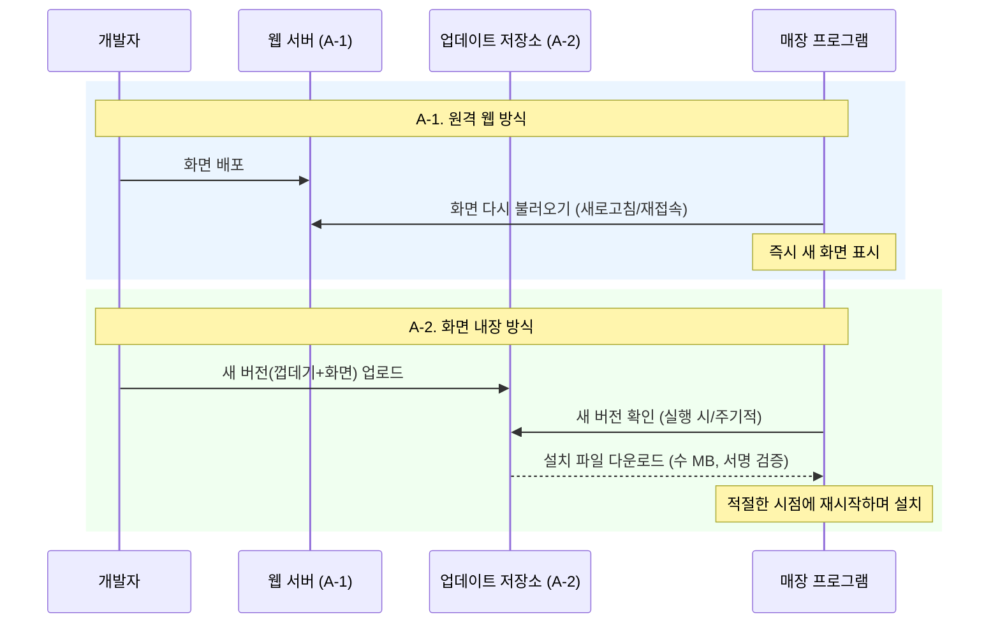

# [협의 요청] 매장 주문접수 프로그램의 화면 배포 방식

> **문서 상태**: 협의용 초안
> **작성**: 매장 주문접수 프로그램 담당
> **성격**: 두 방식을 중립적으로 비교한 자료입니다. 특정 방식을 권장하지 않습니다.
> **결정 필요 사항**: 프로그램 화면(UI)을 **A-1. 원격 웹 방식**과 **A-2. 화면 내장 방식** 중 어느 쪽으로 배포할지
> **전제**: 기술 스택 1순위 후보는 **Tauri(Rust) + Next.js**입니다. 두 방식 모두 이 스택으로 구현할 수 있습니다.

---

## 1. 배경

- 매장 POS PC(Windows)에 설치하는 주문접수 프로그램을 만듭니다. 고객 앱 결제 완료 주문을 받아 알림 → 접수/거절 → 주문서 출력 → 제조 완료 → 픽업 완료를 처리합니다.
- 프로그램은 두 부분으로 구성됩니다.
  - **껍데기(Tauri, Rust)**: 백엔드 실시간 연결 유지, 프린터 출력, 알림음, 트레이 상주, 자동 실행
  - **화면(Next.js)**: 주문 목록, 접수·거절 버튼 등 UI
- 이 화면을 **어디에 두고 어떻게 업데이트할지**에 따라 운영 방식, 장애 대응, 인프라 책임이 달라지므로 협의가 필요합니다.

---

## 2. 두 방식 한눈에 보기

### A-1. 원격 웹 방식 (모바일 하이브리드 앱과 같은 구조)

프로그램은 껍데기만 설치하고, 웹뷰가 **우리가 운영하는 웹 주소**를 불러옵니다.

```
┌─ 매장 POS PC ──────────────────────────────┐          ┌─ 웹 서버 (신규 운영 필요) ─┐
│  Tauri 껍데기 (Rust)                        │          │                          │
│   · 백엔드 실시간 연결 · 프린터 · 알림음       │  HTTPS   │   Next.js 웹 애플리케이션   │
│   ┌─ 웹뷰 ────────────────────────────┐     │ ───────▶ │   (SSR 등 전체 기능 사용)   │
│   │  https://pos.whale.example 로딩    │     │          │                          │
│   └───────────────────────────────────┘     │          └──────────────────────────┘
└────────────────────────────────────────────┘
화면 수정 → 웹 서버에 배포 → 매장 화면 즉시 반영 (프로그램 재설치 없음)
```

### A-2. 화면 내장 방식

Next.js 화면을 정적 파일로 내보내 **프로그램 안에 함께 넣어** 배포합니다. 업데이트는 Tauri 자동 업데이트로 프로그램 전체(껍데기 + 화면)를 교체합니다.

```
┌─ 매장 POS PC ──────────────────────────────┐          ┌─ 업데이트 파일 저장소 ──────┐
│  Tauri 껍데기 (Rust)                        │          │  (S3, GitHub Releases 등)  │
│   · 백엔드 실시간 연결 · 프린터 · 알림음       │  주기적   │                          │
│   ┌─ 웹뷰 ────────────────────────────┐     │  확인     │   새 버전 설치 파일 + 서명  │
│   │  내장된 Next.js 정적 파일 표시      │     │ ───────▶ │   (파일만 올려 두면 됨)     │
│   └───────────────────────────────────┘     │          └──────────────────────────┘
└────────────────────────────────────────────┘
화면 수정 → 새 버전 빌드 → 저장소에 업로드 → 매장 프로그램이 자동으로 내려받아 설치
```

### 2.1 할 수 있는 기능은 두 방식이 같습니다

두 방식의 차이는 **화면 파일을 어디에서 가져오는가** 하나입니다. 프로그램이 할 수 있는 일은 같습니다.

| 기능 | 담당 | A-1 | A-2 |
|---|---|---|---|
| 주문 실시간 수신, 수신 확인, 놓친 주문 조회 | 껍데기(Rust) | 가능 | 가능 |
| 알림음, 트레이 상주, 자동 실행 | 껍데기(Rust) | 가능 | 가능 |
| 주문서 프린터 출력 | 껍데기(Rust) | 가능 | 가능 |
| 주문 목록 표시, 접수·거절 버튼 | 화면 | 가능 | 가능 |
| 화면에서 프린터 출력 등 PC 기능 호출 | 화면 → 껍데기 | 가능 (허용할 웹 주소를 설정에 등록) | 가능 (기본값) |

- A-1에서도 웹 서버에서 내려온 화면이 프린터 같은 PC 기능을 부를 수 있습니다. Tauri 설정에 허용할 웹 주소를 적어 두는 방식입니다(리서치 문서 3.8절).
- 따라서 이 협의는 "어느 쪽이 가능한가"가 아니라 **"운영 책임과 위험을 어디에 둘 것인가"** 를 정하는 것입니다. 차이는 3~4장에 정리했습니다.

---

## 3. 업데이트 흐름 비교



### 3.1 A-2의 업데이트 적용 시점

A-2는 업데이트를 설치할 때 프로그램이 재시작됩니다(Windows 설치 프로그램 특성상 설치 중 프로그램 종료). Tauri 업데이트 기능은 **확인 → 다운로드 → 설치 → 재시작**을 단계별로 호출할 수 있어, 적용 시점을 정책으로 정할 수 있습니다.

**영업 종료 후 다음 날 시작 시 적용하는 흐름**

```
POS PC 켜짐 → 프로그램 자동 실행
   │
   ├─ 새 버전 확인 ──── 없음 ─────────────────────────▶ 정상 시작
   │
   └─ 있음 → 다운로드 → 서명 검증 → 설치 → 자동 재시작 → 새 버전으로 시작
                │
                └─ 인터넷 미연결 / 실패 / 시간 초과 → 기존 버전으로 정상 시작 (다음 기회에 재시도)
```

**적용 시점 선택지**

| 방식 | 동작 | 장점 | 단점 |
|---|---|---|---|
| ① 시작 시 확인·설치 | 프로그램 시작 시 확인 후 바로 설치 | 구현이 가장 단순 | 시작 시간이 업데이트만큼 늘어남 |
| ② 영업 중 다운로드 → 다음 시작 시 설치 | 영업 중에는 내려받기만, 다음 시작 시 설치 | 영업 중 재시작 없음, 시작 지연 최소 | 수정 사항이 다음 영업일에 반영됨. **Tauri 기본 기능이 아니라 직접 만들어야 함** (아래 설명) |
| ③ 영업 중 유휴 시점 설치 | 처리 중인 주문이 없고 일정 시간 조용할 때 설치 | 당일 반영 가능 | 유휴 판단 로직 필요, 영업 중 재시작 발생 |

> **②안은 추가 개발이 필요합니다 (2026-11-16 검증).** Tauri 업데이트 기능은 내려받은 파일을 메모리에만 두기 때문에 프로그램을 끄면 사라집니다. ②안을 쓰려면 내려받은 파일을 디스크에 저장해 두었다가 다음 시작 때 설치하는 부분을 직접 만들어야 합니다(업데이터 플러그인 2.14.0 이상의 Rust API 사용). 추가 개발 없이 쓸 수 있는 것은 ①안과 ③안입니다. 근거: `docs/reviews/2026-11-16-docs-verification.md` H1

추가 개발 없이 시작하려면 **①을 기본으로, 긴급 수정만 ③**으로 적용합니다. ②는 시작 지연이 문제가 될 때 검토합니다.

**설계 시 전제 조건**

- **업데이트가 시작을 막지 않음**: 확인·다운로드에 시간 제한을 두고, 실패하면 기존 버전으로 즉시 시작합니다.
- **관리자 권한 프롬프트(UAC) 회피**: Tauri NSIS 설치 프로그램의 기본값은 "현재 사용자용"(`currentUser`, `%LOCALAPPDATA%` 설치, 관리자 권한 불필요)입니다. "모든 사용자용"(`perMachine`)은 관리자 권한이 필요합니다. 업데이트 설치 모드 중 진행 창 없이 설치하는 `quiet`는 현재 사용자용 설치이거나 앱이 관리자 권한으로 실행 중일 때만 동작합니다. 따라서 매장 직원이 관리자 비밀번호를 모르는 환경에서는 현재 사용자용 설치가 전제가 됩니다. ("모든 사용자용" 설치에서 업데이트마다 UAC 창이 뜨는지는 공식 문서로 확인되지 않음. 근거: 리서치 문서 3.3~3.4절)
- **업데이트 설치 중 주문 수신 중단**: Windows에서는 업데이트 설치 단계에서 앱이 자동으로 종료됩니다(Tauri 공식 문서). 위 적용 시점 정책이 필요한 이유입니다.
- **서명 키 분실 = 업데이트 불가**: 업데이트 서명은 끌 수 없고, 비밀키를 잃어버리면 이미 설치된 매장에는 새 업데이트를 배포할 수 없습니다(Tauri 공식 문서).
- **전원 차단 대응**: ①안은 시작할 때 내려받아 바로 설치하므로, 영업 종료 때 POS 전원을 바로 내려도 영향이 없습니다. ②안은 내려받은 파일을 디스크에 저장하도록 만든 경우에만 같습니다.

> A-1도 Rust 껍데기를 변경할 때는 같은 업데이트 장치가 필요합니다. 다만 껍데기 변경 빈도가 낮아 적용 시점 정책의 중요도는 A-2보다 낮습니다.

---

## 4. 상세 비교

| 항목 | A-1. 원격 웹 방식 | A-2. 화면 내장 방식 |
|---|---|---|
| **화면 수정 반영 속도** | 웹 배포 즉시 전 매장 반영 | 자동 업데이트 확인 주기와 재시작 시점에 따름 |
| **매장 간 화면 버전 일관성** | 전 매장이 항상 같은 화면 버전 | PC가 꺼져 있거나 업데이트에 실패한 매장은 구버전으로 남을 수 있음 |
| **문제 버전 되돌리기** | 웹 재배포로 즉시 | 이전 버전을 새 버전으로 다시 배포 → 각 매장이 다시 내려받아 설치 |
| **재시작 필요 여부** | 화면 변경 시 불필요 | 업데이트 설치 시 재시작 필요 → 적용 시점 정책으로 영업 중 재시작 회피 가능 (3.1 참고) |
| **인터넷 끊김 시 화면** | 이미 떠 있는 화면은 유지됨. 끊긴 상태에서 프로그램을 켜거나 새로고침하면 화면을 불러올 수 없음 → 껍데기에 대체 화면 내장 필요 | 화면은 항상 표시됨 |
| **인터넷 끊김 시 주문 수신** | 중단 (두 방식 동일) | 중단 (두 방식 동일) |
| **신규 운영 인프라** | 웹 서버 운영 필요 (배포, 모니터링, 장애 대응, 비용) | 정적 파일 저장소만 필요 |
| **서버 장애 영향** | 웹 서버 장애 시 전 매장 화면 영향 | 저장소 장애 시 업데이트만 지연 |
| **Next.js 기능 범위** | 전체 사용 가능 (SSR, API Routes 등) | 정적 내보내기 범위만 사용 가능 |
| **껍데기 ↔ 화면 버전 정합성** | 웹(최신)과 껍데기(구버전)가 어긋날 수 있음 → 껍데기 버전 확인 등 호환성 설계 필요 | 껍데기와 화면이 같은 패키지로 배포되어 항상 일치 |
| **보안 경계** | 원격 출처에 PC 기능(프린터 등) 호출 권한 부여 → 허용 도메인 제한, HTTPS 필수, 웹 서버 보안이 매장 PC 보안과 연결됨 | 로컬 번들에만 PC 기능 호출 권한 부여 |
| **매장별 단계적 배포** | 웹 서버에서 매장별 분기·기능 플래그로 구현 | 업데이트 채널(파일럿/전체) 분리로 구현 |
| **배포 산출물 크기** | 껍데기만 설치, 화면은 매번 네트워크로 로드 (캐시 전략 필요) | 껍데기 + 화면 전체를 패키지로 배포 (수 MB 수준) |
| **초기 구축 항목** | 웹 서버 + 배포 파이프라인 + 대체 화면 + 호환성 설계 + 원격 권한 설정 | 업데이트 서명 키 관리 + 업데이트 저장소 + 적용 시점 정책 |

---

## 5. 방식별 필요 사항

### A-1을 선택할 경우

| 필요 사항 | 담당 협의 |
|---|---|
| Next.js 웹 서버 호스팅 (서버 또는 Vercel 등) 및 비용. **현재 이 용도의 웹 서버는 없어 새로 구축해야 함** | 인프라 담당 |
| 도메인, HTTPS 인증서 | 인프라 담당 |
| 웹 배포 파이프라인, 장애 모니터링 | 인프라 / 개발 |
| 껍데기 내장 "연결 끊김" 대체 화면 | 개발 |
| 웹 ↔ 껍데기 버전 호환성 확인 로직 | 개발 |
| Tauri 원격 페이지 권한 설정 (허용 도메인 제한) | 개발 / 보안 검토 |
| 껍데기 자체 업데이트 (빈도는 낮지만 필요) | 개발 (A-2와 동일 장치 필요) |

### A-2를 선택할 경우

| 필요 사항 | 담당 협의 |
|---|---|
| 업데이트 파일 저장소 (S3, GitHub Releases 등) | 인프라 담당 |
| 업데이트 서명 키 보관 (분실 시 기존 설치 매장 업데이트 불가) | 보안 / 개발 |
| 업데이트 적용 시점 정책 (처리 중 주문 없을 때, 영업 종료 후 등) | 개발 / 운영 |

### 공통

| 필요 사항 | 비고 |
|---|---|
| **Windows 코드 서명 인증서** | 없으면 설치 시 "알 수 없는 게시자" 경고. 유료(연 단위), 회사 명의 구매 필요 |
| 껍데기 자동 업데이트 장치 | A-1도 Rust 껍데기 변경 시 필요 |
| WebView2 런타임 | 두 방식 모두 필요. 인터넷이 약한 매장은 오프라인 설치 방식(`offlineInstaller` 약 127MB, `fixedRuntime` 약 180MB)을 고려. 상시 실행 중인 앱은 재시작 전까지 이전 WebView2 버전을 계속 사용 (리서치 문서 3.2절) |

---

## 6. 판단 기준: 어느 쪽이 유리한 조건인가

| 조건 | 유리한 방식 |
|---|---|
| 파일럿 기간 중 화면 수정이 잦고, 수정 사항을 즉시 전 매장에 반영해야 함 | A-1 |
| 회사에 이미 운영 중인 웹 인프라와 운영 인력이 있음 | A-1 |
| 매장별 실험(일부 매장만 다른 화면)을 자주 할 예정 | A-1 |
| 전 매장의 화면 버전을 항상 동일하게 유지하는 것이 중요함 | A-1 |
| 매장 인터넷이 불안정하거나, 인터넷 끊김 중에도 화면이 유지되어야 함 | A-2 |
| 신규 서버 운영을 늘리지 않아야 함 (운영 인력·비용 제약) | A-2 |
| 원격 출처에 PC 기능 권한을 여는 보안 부담을 피하고 싶음 | A-2 |
| 껍데기와 화면의 버전 정합성 관리를 단순하게 하고 싶음 | A-2 |

> 참고: 두 방식을 섞는 변형도 가능합니다(예: 화면을 내장하되 일부 화면만 원격 로딩). 다만 두 방식의 운영 항목을 모두 떠안게 되므로, 필요가 확인될 때 검토하는 것을 전제로 합니다.

---

## 7. 협의 시 결정할 것

| # | 결정 사항 | 선택지 |
|---|---|---|
| 1 | 화면 배포 방식 | A-1 원격 웹 / A-2 화면 내장 |
| 2 | 인프라 제공 | (A-1) 웹 서버 호스팅 주체·비용 / (A-2) 업데이트 파일 저장소 위치 |
| 2-1 | (A-1) 웹 서버 구축·운영 담당 | 현재 서버가 없음. 누가 구축하고, 장애가 나면 누가 대응하는지 (인프라 / 백엔드 팀 / 매장 프로그램 담당) |
| 3 | Windows 코드 서명 인증서 | 구매 여부, 구매 주체 |
| 4 | 서명 키 보관 | 보관 위치와 담당자 |
| 5 | 화면 변경 예상 빈도 | 파일럿 기간 중 화면 수정이 얼마나 잦을지 (A-1/A-2 판단 근거) |
