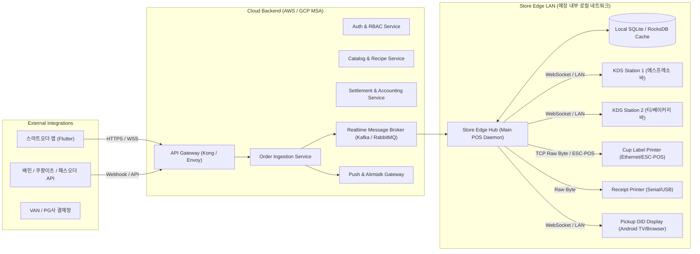
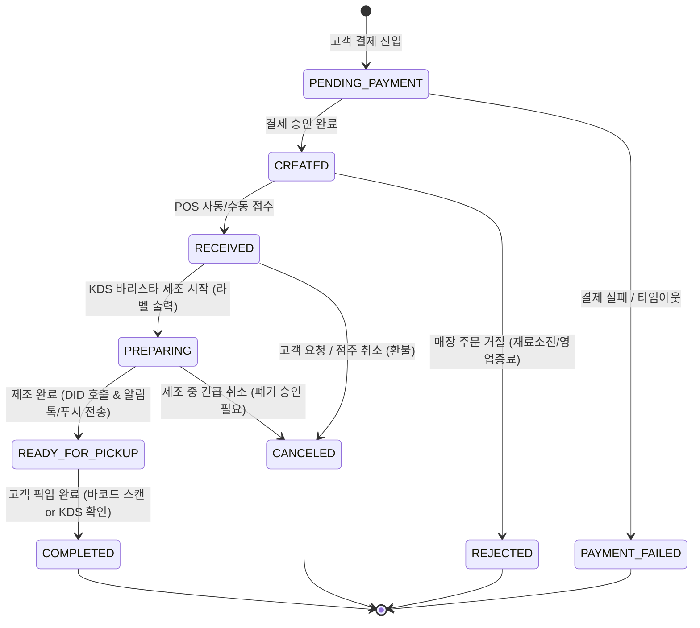
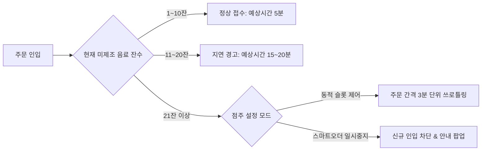
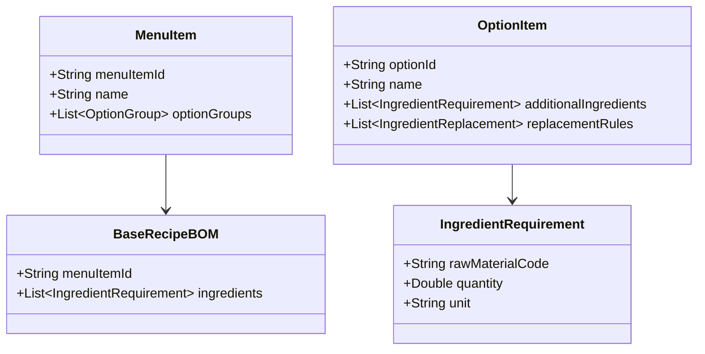
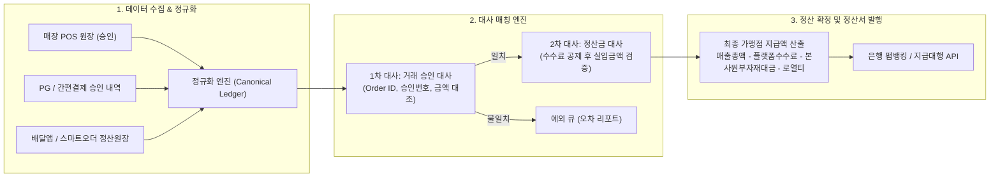
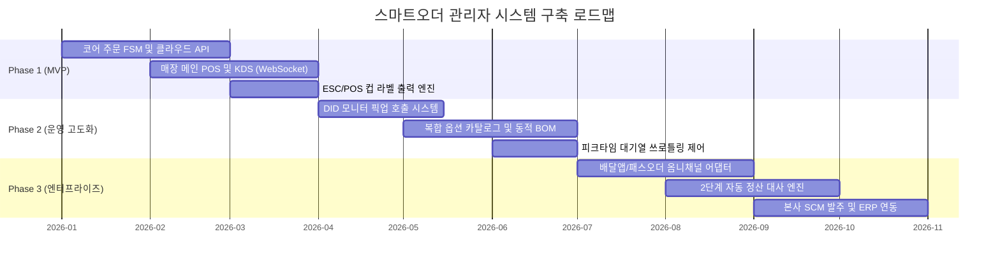

# 커피숍 스마트오더 관리자 시스템 아키텍처 및 기능 구성 심층 리서치

> **⚠️ 읽기 전 안내 (2026-11-12 추가)**
> - 이 문서는 Antigravity로 수집한 **업계 전반 리서치**이며 출처가 없습니다. 이 프로젝트 범위의 근거는 `docs/research/store-order-receiver-tech-research.md`(1차 출처 기반)를 우선합니다.
> - **계속 참고할 부분**: 3.1 주문 FSM, 3.3 피크타임 제어 아이디어, 4장 메뉴·옵션 구조 (각각 보완 필요)
> - **버려도 되는 부분**: 1~2장, 3.2 통신 권장안, 5장(특히 5.3 ESC/POS 설명은 오류), 6~9장
> - 상세 비교: `docs/research/research-comparison.md`


> **문서 상태**: 최종 리서치 보고서  
> **대상 도메인**: F&B(커피 프랜차이즈 및 개인 카페) 스마트오더 & 매장 운영 관리 플랫폼  
> **분석 대상**: 본사 가맹본부(HQ), 가맹점주(Store Owner), 현장 매장(POS/KDS/DID/라벨프린터), 옴니채널 중계  
> **벤치마크 레퍼런스**: 스타벅스(사이렌오더), 패스오더(PassOrder), 메가MGC커피/컴포즈커피, 토스플레이스, 배민포스/오케이포스  

---

## 1. 개요 및 배경 (Executive Summary)

### 1.1 F&B 커피 전문점 스마트오더의 특수성
커피 전문점(Coffee Specialty Shop & Franchise)은 일반 외식업(식당, 주점 등)과 비교할 때 운영 및 트래픽 패턴에서 뚜렷한 기술적 차별성을 지닙니다.

1. **극단적인 피크타임 트래픽 집중**:
   - 출근 시간대(08:00~09:30) 및 점심 직후(12:00~13:30)에 일일 전체 거래의 **65% 이상**이 집중됩니다.
   - 초당 주문 인입(TPS)이 급증하며, 고객의 대기 시간 허용치(SLA)는 통상 **3분~5분 이내**로 매우 짧습니다.
2. **복합 커스텀 옵션(Combinatorial Customization)**:
   - 음료 한 잔당 [온도(HOT/ICE)] × [사이즈] × [원두(디카페인 등)] × [에스프레소 샷 조절] × [우유 종류(오트/두유/락토프리)] × [시럽/당도/얼음량] × [컵 타입] 등 조합 가능한 경우의 수가 수백~수천 가지에 달합니다.
3. **높은 테이크아웃/픽업 비중 및 하드웨어 의존도**:
   - 매장 내 좌석 착석보다 픽업/테이크아웃 비중이 70~80%에 달하므로, **라벨 프린터 출력(컵 부착)**, **KDS(주방 디스플레이) 동선 최적화**, **DID(픽업 모니터) 및 실시간 알림톡/푸시 호출** 간의 지연 시간(Latency)이 매장 회전율을 결정합니다.
4. **온·오프라인 옴니채널 파편화**:
   - 자체 스마트오더 앱뿐만 아니라 패스오더, 네이버 스마트주문, 배달앱 3사(배달의민족, 쿠팡이츠, 요기요), 매장 현장 POS 및 키오스크가 단일 주방(바리스타 바)을 공유하므로 **단일 진실 공급원(Single Source of Truth, SSOT)** 체계 구축이 필수적입니다.

---

## 2. 관리자 시스템 전체 아키텍처 및 역할 계층

### 2.1 계층 구조 및 역할 분담 (Role Hierarchy)

커피숍 관리자 시스템은 권한과 물리적 위치에 따라 **3대 핵심 계층**으로 분리됩니다.

```
┌────────────────────────────────────────────────────────────────────────┐
│                   Level 1: 가맹본부 본사 (HQ Admin)                    │
│   전국 가맹점 모니터링 | 마스터 카탈로그(BOM) | 프로모션/정산 정책 | SCM 물류   │
└───────────────────────────────────┬────────────────────────────────────┘
                                    │ Policy & Sync
┌───────────────────────────────────┴────────────────────────────────────┐
│                  Level 2: 가맹점주 (Store Owner Web/App)                │
│    매장 영업 스케줄 | 일일 마감/정산 | 로컬 재고/발주 | 배달/스마트오더 채널 제어   │
└───────────────────────────────────┬────────────────────────────────────┘
                                    │ Edge Dispatch & Telemetry
┌───────────────────────────────────┴────────────────────────────────────┐
│               Level 3: 매장 현장 단말 (In-Store Edge Devices)            │
│  [메인 POS] ──LAN── [KDS(주방 바리스타)] ──LAN── [라벨/영수증 프린터 (ESC/POS)] │
│     │                                                                  │
│     └──────────────LAN── [DID 픽업 호출 모니터 (Web/Android TV)]         │
└────────────────────────────────────────────────────────────────────────┘
```

#### 역할 기반 접근 제어 (RBAC Matrix)

| 구분 | 시스템 유형 | 주요 역할 및 권한 경계 | 세션 및 인증 특성 |
| :--- | :--- | :--- | :--- |
| **HQ 마스터 / 슈퍼바이저(SV)** | 반응형 웹 콘솔 (PC) | 전국 매장 통합 매출 모니터링, 글로벌 메뉴/BOM 등록, 가맹점 계약 및 수수료율 설정, 본사 공급가 관리, 전사 프로모션 집행, 가맹점 감사 로그 열람 | SSO (OAuth2 / SAML), MFA(다단계 인증) 필수, 세션 만료 30분 |
| **가맹점주 (Owner)** | 반응형 웹 & 모바일 앱 (iOS/Android) | 본인 매장 일일 매출/마감 조회, 입금 계좌/정산 대사 내역 확인, 본사 원부자재 발주 신청, 직원(알바) 근무표 및 권한 계정 발급, 매장 운영 상태 토글 | 모바일 생체 인증(FaceID/지문) 또는 자동 로그인, 푸시 토큰 관리 |
| **매장 매니저 / 바리스타** | 현장 POS 및 태블릿 KDS | 실시간 주문 접수/거절, 제조 상태 변경(접수→제조→완료), 임시 품절 설정, 주문 지연 시간 설정, 영수증/라벨 재출력, 현금 시재 정산 | POS PIN 번호(4~6자리 간편 로그인) 또는 매장 공용 고정 디바이스 세션 |
| **홀/픽업 고객 (Consumer)** | DID 모니터 / 키오스크 | 주문 대기 번호 확인, 본인 음료 준비 완료 상태 인지 (수동 조작 불가, Read-only 디스플레이) | 무인 키오스크 세션(주문 완료 시 리셋) 또는 전광판 웹소켓 수신 클라이언트 |

---

### 2.2 클라우드-엣지 하이브리드 토폴로지 (Cloud-Edge Hybrid Topology)

중앙 클라우드 장애나 매장 인터넷 회선 장애 발생 시에도 현장 결제와 제조가 중단되지 않아야 하므로, **하이브리드 엣지(Edge) 아키텍처**를 채택합니다.



#### 오프라인 내결함성(Offline Resilience) 전략
1. **Local-First 주문 보관**:
   - 매장 인터넷 단절 시, 메인 POS의 Edge Daemon이 로컬 SQLite에 주문 및 오프라인 결제(VAN사 오프라인 승인)를 기록합니다.
   - 네트워크 복구 시 지수 백오프(Exponential Backoff)를 적용하여 클라우드로 멱등(Idempotent) 동기화를 수행합니다.
2. **KDS 및 프린터 LAN 직결**:
   - KDS와 프린터는 외부 인터넷이 아닌 **매장 공유기(LAN Subnet)** 상에서 Edge Hub와 직접 TCP 소켓 통신을 수행하므로 인터넷 단절 중에도 현장 주문 처리 및 티켓/라벨 출력이 100% 정상 작동합니다.

---

## 3. 실시간 주문 처리 및 매장 운영 관리

### 3.1 주문 라이프사이클 유한 상태 머신 (Finite State Machine, FSM)

커피숍 주문은 접수부터 픽업까지 단계별 전환이 엄격히 제어되어야 합니다.



#### 주문 상태별 상세 스펙 및 트리거 액션

| 상태 코드 (State) | 표시명 | 전이 조건 (Transition Trigger) | 트리거되는 부가 작업 (Side Effects) |
| :--- | :--- | :--- | :--- |
| `CREATED` | 주문 요청 | 모바일 앱에서 PG 결제 승인 완료 | POS 알림음(Ding-Dong) 발생, 자동 접수 모드 시 3초 내 `RECEIVED` 자동 전환 |
| `RECEIVED` | 주문 접수 | 점주 POS 수락 버튼 클릭 or 자동 수락 규칙 | 예상 소요시간 산출 후 고객 앱 푸시 전달, KDS 대기열 큐 삽입 |
| `PREPARING` | 제조 중 | 바리스타가 KDS에서 주문 터치 | **ESC/POS 라벨 프린터로 컵 라벨 자동 인쇄**, DID에 '제조 중' 목록 노출 |
| `READY_FOR_PICKUP`| 준비 완료 | 바리스타가 KDS에서 완료 터치 | **DID 픽업 전광판 번호 팝업 & 벨/TTS 안내음 송출**, **카카오 알림톡/앱 푸시 발송** |
| `COMPLETED` | 픽업 완료 | 바리스타 전달 확인 or 고객 수령 바코드 스캔 | 주문 세션 종료, 재고 BOM 최종 차감 확정, 스탬프/포인트 적립 완료 |
| `REJECTED` | 접수 거절 | 점주 사유 선택(재료 소진, 주문 폭주 등) | PG사 자동 결제 취소 API 호출, 고객 앱 취소 사유 안내 알림 |
| `CANCELED` | 취소/환불 | 고객 앱 취소(제조 전만 허용) or 점주 강제 취소 | PG 환불 처리, KDS 큐에서 자동 제거, 원부자재 복구 처리 |

---

### 3.2 실시간 양방향 통신 프로토콜 비교 및 최적 조합

스마트오더 시스템은 채널별 특성에 맞춰 통신 프로토콜을 계층적으로 혼합 구성해야 통신 비용과 신뢰성을 동시에 확보할 수 있습니다.

| 프로토콜 | 적용 영역 | 장점 | 단점 및 극복 방안 |
| :--- | :--- | :--- | :--- |
| **WebSocket** | • POS ↔ Cloud Core Server<br>• POS ↔ KDS/DID (매장 LAN) | • 전이중(Full-duplex) 실시간 통신<br>• 10ms 이하 초저지연 상태 동기화 | 연결 유지 부하 발생 가능. 매장 내부 LAN에서는 로컬 WebSocket 서버 가동으로 해결 |
| **SSE (Server-Sent Events)** | • 가맹점주 웹 어드민 대시보드<br>• 모바일 고객 주문 상태 추적 | • HTTP/2 기반 경량 단방향 스트리밍<br>• 방화벽 친화적, 자동 재연결 내장 | 클라이언트→서버 통신 불가 (REST API로 분리 전송) |
| **MQTT** | • 저사양 POS 단말 및 이동형 주문 패드 | • QoS Level 1/2로 네트워크 불안정 환경에서 메시지 유실 방지<br>• 저전력/저대역폭 | 브로커(EMQX/HiveMQ) 인프라 관리 복잡도 수반 |
| **FCM / APNs (Push)** | • 고객 모바일 앱 백그라운드 알림<br>• 점주용 모바일 앱 긴급 알림 | • 앱이 꺼져 있어도 OS 레벨 수신 보장 | 전송 지연(수초~수분) 발생 가능 → 포그라운드는 WebSocket/SSE를 메인으로 사용 |

> **최적 아키텍처 권장안**:
> - **매장 내부 (Edge LAN)**: 로컬 POS 내 WebSocket 브로커를 구동하여 KDS, DID, 모바일 POS 간 지연 없는 즉각적 상태 동기화 달성.
> - **클라우드 ↔ 매장**: MQTT(QoS 1) 또는 지속형 WebSocket을 통해 주문 누락 방지 및 양방향 Heartbeat 핑퐁 유지.
> - **클라우드 ↔ 모바일 고객**: 포그라운드 진입 시 SSE/WebSocket 스트림 수신, 백그라운드 시 카카오 알림톡 + FCM/APNs 듀얼 발송.

---

### 3.3 피크타임 주문 폭주 제어 및 백프레셔(Backpressure) 전략

출근/점심 피크타임 시 주문이 밀려 매장 처리 능력을 초과하면 고객 불만과 음료 품질 저하가 발생합니다. 이를 통제하기 위한 3단계 제어 로직이 요구됩니다.



1. **대기 큐 기반 동적 예상 대기시간 알고리즘**:
   $$\text{예상 소요시간}(T) = \sum_{i=1}^{N} (\text{음료}_i \text{ 기본 제조시간} \times \text{복잡도 계수}) \div \text{활성 바리스타 수} + \text{버퍼(2분)}$$
   - 에스프레소류: 기본 45초 / 블렌디드·프라푸치노류: 90초 / 핸드드립: 180초.
   - 주문 승인 시 이 계산된 시간이 앱 화면에 "현재 대기 12번째, 약 18분 소요 예상"으로 실시간 표기됩니다.
2. **원클릭 '주문 일시 정지(Pause)' 및 '시간 지연(+10분)' 토글**:
   - POS 화면 상단에 항시 노출되는 핫키(Hot-key)로 매장 직원이 즉시 스마트오더 인입을 10분/20분/30분간 일시 중단하거나 일괄 15분 추가 지연을 적용할 수 있습니다.
3. **실시간 메뉴 및 옵션 단위 품절(Sold-Out) 전파**:
   - 우유, 특정 원두(디카페인), 벤티 컵 등 특정 자재 소진 시, 해당 자재를 사용하는 전체 메뉴/옵션이 **원클릭으로 품절 전환**되어 배달앱/스마트오더/키오스크에 즉시 반영되어야 합니다.

---

## 4. 메뉴 및 복합 옵션 카탈로그 체계

### 4.1 카탈로그 계층 모델 (Catalog Data Hierarchy)

커피 전문점의 카탈로그는 단순 상품-옵션 구조를 넘어 다차원 종속성을 수용할 수 있어야 합니다.

```
Category (예: 에스프레소 음료)
  │
  └── Menu Item (예: 카페라떼)
        │
        ├── Option Group 1: [온도 선택] (필수 1개)
        │     ├── Hot (+0원)
        │     └── Ice (+0원)
        │
        ├── Option Group 2: [사이즈 선택] (필수 1개)
        │     ├── Regular (기본)
        │     └── Large (+700원) ──> [BOM 연동: 샷+1, 우유+100ml, 16oz컵]
        │
        ├── Option Group 3: [원두 원산지/타입] (필수 1개)
        │     ├── 시그니처 다크 블렌드 (+0원)
        │     └── 디카페인 블렌드 (+500원)
        │
        ├── Option Group 4: [에스프레소 샷 커스텀] (선택 / 수량 증감)
        │     ├── 샷 추가 (+500원 / 최대 4샷)
        │     └── 연하게 (-1샷 / +0원)
        │
        ├── Option Group 5: [우유/베이스 변경] (선택 1개)
        │     ├── 일반 우유 (+0원)
        │     ├── 저지방 우유 (+0원)
        │     ├── 두유 (소이밀크) (+500원)
        │     └── 오트 (귀리 우유) (+800원)
        │
        ├── Option Group 6: [시럽 및 당도] (선택 / 수량 증감)
        │     ├── 바닐라 시럽 (+500원 / 펌프 수 1~5)
        │     ├── 헤이즐넛 시럽 (+500원 / 펌프 수 1~5)
        │     └── 스테비아 대체당 (+400원)
        │
        └── Option Group 7: [컵 선택] (필수 1개)
              ├── 매장용 다회용 머그/유리잔 (+0원)
              ├── 일회용 플라스틱/종이컵 (+0원)
              └── 개인 텀블러 지참 (-300원 에코 할인)
```

---

### 4.2 옵션 종속성 및 검증 스키마 (JSON Data Contract)

온도(HOT/ICE)에 따라 선택 가능한 하위 옵션이 달라지는 등 **조건부 종속성(Conditional Dependency)**을 지원해야 합니다.

```json
{
  "$schema": "https://json-schema.whale.io/catalog-item.json",
  "itemId": "menu_caffe_latte",
  "name": "카페 라떼",
  "basePrice": 4500,
  "category": "COFFEE_ESPRESSO",
  "optionGroups": [
    {
      "groupId": "opt_grp_temp",
      "name": "온도 선택",
      "required": true,
      "minSelect": 1,
      "maxSelect": 1,
      "options": [
        { "optionId": "opt_hot", "name": "HOT", "priceDelta": 0 },
        { "optionId": "opt_ice", "name": "ICE", "priceDelta": 0 }
      ]
    },
    {
      "groupId": "opt_grp_ice_amount",
      "name": "얼음량",
      "required": false,
      "parentCondition": {
        "groupId": "opt_grp_temp",
        "selectedOptionId": "opt_ice"
      },
      "options": [
        { "optionId": "opt_ice_less", "name": "얼음 적게", "priceDelta": 0 },
        { "optionId": "opt_ice_normal", "name": "보통 얼음", "priceDelta": 0 },
        { "optionId": "opt_ice_more", "name": "얼음 가득", "priceDelta": 0 }
      ]
    },
    {
      "groupId": "opt_grp_milk",
      "name": "우유 변경",
      "required": true,
      "minSelect": 1,
      "maxSelect": 1,
      "options": [
        { "optionId": "milk_regular", "name": "일반 우유", "priceDelta": 0, "bomCode": "MAT_MILK_REG" },
        { "optionId": "milk_oat", "name": "오트밀크(귀리)", "priceDelta": 800, "bomCode": "MAT_MILK_OAT" }
      ]
    }
  ]
}
```

---

## 5. 매장 하드웨어 및 외부 연동

### 5.1 하드웨어 에코시스템 구성도

```
                      [Cloud POS Server]
                              │
                    (Internet / WSS / HTTPS)
                              │
                    ┌─────────▼────────┐
                    │ Store Main POS   │
                    │ (Windows / Android)
                    └────┬───┬───┬───┬─┘
                         │   │   │   │
        ┌────────────────┘   │   │   └────────────────┐
        │ LAN (Ethernet)     │   │ Ethernet (TCP)     │ USB / Serial
        ▼                    │   ▼                    ▼
┌──────────────┐             │ ┌──────────────┐ ┌──────────────┐
│ KDS Station  │             │ │ Label Printer│ │ReceiptPrinter│
│ (Tablet/AIO) │             │ │ (ESC/POS)    │ │ (ESC/POS)    │
└───────┬──────┘             │ └──────────────┘ └──────────────┘
        │ WebSocket          │
        ▼                    ▼ LAN (WebSocket)
┌──────────────┐       ┌──────────────┐
│ DID Monitor  │       │ Sub-KDS      │
│ (Smart TV)   │       │ (Bakery/Bar) │
└──────────────┘       └──────────────┘
```

---

### 5.2 KDS(Kitchen Display System) 설계 기준

KDS는 단순 주문 텍스트 나열이 아닌, 바리스타의 제조 속도와 실수를 줄여주는 UX로 구성되어야 합니다.

1. **3단 화면 뷰 모드**:
   - **티켓 뷰(Ticket View)**: 주문 건별 카드 형태 정렬. 경과 시간에 따라 테두리 색상 변화 (초록: <3분, 노랑: 3~5분, 빨강 점멸: >5분).
   - **아이템 합산 뷰(Item Aggregation View)**: "현재 아메리카노 5잔, 라떼 3잔 대기 중"과 같이 일괄 추출을 돕는 집계 화면.
   - **완료 및 히스토리 뷰**: 방금 완료 처리한 주문을 즉시 복구(Undo)하거나 재출력하는 기능.
2. **사운드 피드백**:
   - 신규 주문 발생 시 주방 소음을 뚫고 들릴 수 있는 85dB 이상의 비프음 발생.
3. **스테이션 라우팅 (Station Routing)**:
   - 복합 매장의 경우: 에스프레소 음료는 `Bar-KDS`로, 샌드위치/베이커리류는 `Kitchen-KDS`로 주문 아이템이 자동 분할 라우팅.

---

### 5.3 ESC/POS 기반 컵 라벨 프린터 제어 메커니즘

커피 전문점의 핵심은 **음료 컵에 부착하는 방수 감열 라벨**의 초고속 출력입니다.

#### ESC/POS 바이너리 명령어 구조 (예시: 라벨 서식)
프린터(Bixolon, Sewoo, Xprinter 등)로 전송되는 원시 바이트 스트림 예시입니다:

```text
[초기화]        : 0x1B 0x40 (ESC @)
[정렬 설정]     : 0x1B 0x61 0x01 (ESC a 1 -> 중앙 정렬)
[글자 크기 배율]: 0x1D 0x21 0x11 (GS ! 17 -> 가로/세로 2배 확대)
                "주문 #108" + 0x0A (LF)
[기본 폰트 복구]: 0x1D 0x21 0x00 (GS ! 0)
[좌측 정렬]     : 0x1B 0x61 0x00 (ESC a 0)
                "메뉴: 아이스 카페라떼 (L)" + 0x0A
                "- 오트밀크 변경 (+800)" + 0x0A
                "- 샷 1회 추가 (+500)" + 0x0A
                "- 얼음 적게" + 0x0A
[출력 및 라벨 이송]: 0x1D 0x56 0x42 0x00 (GS V 66 0 -> Gap 센서 위치까지 자동 피드)
```

- **Gap 센서(라벨 간격 인식)**: 연속 용지와 달리 스티커 라벨지는 라벨 간의 간격(Gap)을 정확히 감지해야 글자가 잘리지 않습니다. 드라이버 단에서 페이지 모드(Page Mode) 또는 ZPL/ESC/POS 라벨 모드를 정확히 초기화해야 합니다.
- **다국어 및 한글 완성형 인코딩**: 영수증 프린터의 한글 폰트 지원(CP949 또는 UTF-8 전환 커맨드) 세팅이 필수적입니다.

---

### 5.4 DID (Digital Information Display / 픽업 호출기) 연동

1. **디바이스 사양**: 매장 내 32~55인치 안드로이드 스마트 TV 또는 라즈베리 파이 HDMI 연결 모니터.
2. **연동 프로토콜**: 로컬 WebSocket 수신 전용 웹뷰(SPA HTML5 / Flutter Embedded).
3. **시각 및 음성 동기화**:
   - 상태 변경 수신 시 화면 분할: 좌측 [제조 중(Preparing) 4개 번호] / 우측 [준비 완료(Ready) 대형 팝업].
   - **TTS(Text-To-Speech)** 모듈 연동: "딩동! 108번 고객님, 주문하신 음료가 준비되었습니다." 음성 자동 출력.

---

## 6. 레시피 기반 BOM 소진 및 재고/발주 관리

### 6.1 다차원 BOM(Bill of Materials) 모델링

커피 1잔은 단순 완제품이 아니라 복수의 기초 원부자재 결합체입니다.



#### 카페라떼(Tall) 주문 시 동적 BOM 계산 예시
- **기본 레시피 (Base BOM)**:
  - 에스프레소 원두: `18g`
  - 일반 우유: `180ml`
  - 13oz 테이크아웃 종이컵: `1ea`
  - 13oz 컵 리드(뚜껑): `1ea`
  - 컵홀더 & 스트로우: 각 `1ea`
- **고객 선택 옵션**:
  - `[옵션 1: 샷 추가]` $\rightarrow$ 원두 `+18g` 가산
  - `[옵션 2: 오트밀크 변경]` $\rightarrow$ 일반 우유 `180ml` 차감 **취소**, 오트밀크 `180ml` 신규 차감
- **최종 차감 자재 합계**:
  $$\text{원두 36g} + \text{오트밀크 180ml} + \text{컵 1ea} + \text{리드 1ea} + \text{홀더/빨대 각 1ea}$$

---

### 6.2 단위 환산 및 로스(Loss) 관리

1. **입고 단위 vs 소비 단위 환산**:
   - 원두: 입고 단위 `1kg (Bag)` $\leftrightarrow$ 레시피 단위 `g (Gram)` (환산 배수 1,000)
   - 시럽: 입고 단위 `1,000ml (Bottle)` $\leftrightarrow$ 레시피 단위 `10ml (1 Pump)` (환산 배수 100)
2. **로스율(Loss Factor) 반영**:
   - 원두 그라인더 분쇄 잔류 및 도징 시 날림 손실율(통상 3~5%)을 레시피 소진 계수에 반영 ($18g \times 1.05 = 18.9g$).
   - 개봉 후 유통기한 경과(예: 개봉 우유 48시간) 폐기 처리용 '폐기 등록 기능' 제공.

---

### 6.3 안전재고 경고 및 자동 발주(Auto-Replenishment) 로직

$$\text{발주 권장 수량} = (\text{리드타임 일수} \times \text{일평균 소진량}) + \text{안전재고량} - \text{현재 실재고량} - \text{기발주 입고예정량}$$

- **실시간 품절 알림 트리거**:
  - 안전재고 임계치(Threshold) 미달 시 점주 앱 푸시 발송 및 발주 장바구니 자동 담기.
  - 재고 수량 0 도달 시 연결된 모든 메뉴 **자동 품절 플래그(Auto-Soldout)** 활성화.

---

## 7. 결제, 마감, 정산 및 프로모션 시스템

### 7.1 복합 결제(Split Payment) 흐름

고객은 단일 주문에 대해 여러 할인 및 결제 수단을 복합 적용할 수 있어야 합니다.

```
[총 주문금액: 12,000원]
   │
   ├── 1. 모바일 교환권 (기프티콘) 적용: -4,500원 (잔액: 7,500원)
   ├── 2. 스탬프/포인트 차감 할인: -2,000원 (잔액: 5,500원)
   ├── 3. 선불 충전금(멤버십 페이): -3,000원 (잔액: 2,500원)
   └── 4. 최종 차액 PG/신용카드 결제: 2,500원
```

- **원자적 결제 트랜잭션 (Atomic Settlement)**:
  - 4개 수단 중 마지막 카드 결제가 실패할 경우, 앞서 승인된 포인트 및 기프티콘 사용이 **2단계 커밋(2PC) 또는 보상 트랜잭션(Saga Pattern)**을 통해 전원 원상복구되어야 합니다.

---

### 7.2 옴니채널 정산 대사 엔진 (Reconciliation Engine)

프랜차이즈 본사, 가맹점, 배달 플랫폼, PG사 간의 자금 흐름을 검증하는 2단계 대사 파이프라인입니다.



#### 정산 공제 수식 명세
$$\text{가맹점 최종 정산 입금액} = \text{총 매출액} - (\text{PG수수료} + \text{플랫폼 중개수수료} + \text{본사 로열티} + \text{본사 발주 원부자재 사입대금 상계}) \pm \text{프로모션 분담금}$$

---

## 8. 옴니채널 통합 주문 연동 (Omnichannel Inbound Gateway)

### 8.1 옴니채널 중계 아키텍처

배달의민족, 쿠팡이츠, 요기요, 네이버 주문, 패스오더 등 파편화된 외부 채널을 단일 파이프라인으로 일원화합니다.

```mermaid
flowchart LR
    subgraph ExternalChannels["외부 유입 채널"]
        Baemin["배달의민족"]
        Coupang["쿠팡이츠"]
        Yogiyo["요기요"]
        Naver["네이버 스마트주문"]
        PassOrder["패스오더"]
    end

    subgraph Gateway["Omnichannel Integration Gateway"]
        WebhookReceiver["Webhook / Polling Gateway"]
        Adapter["Channel Adapter (Schema 변환)"]
        CanonQueue["통합 주문 Canonical Queue"]
    end

    subgraph StoreExecution["매장 실행 계층"]
        CoreOrder["Whale Order Engine"]
        EdgePOS["현장 통합 POS"]
        KDS_All["KDS 주방 통합 큐"]
    end

    ExternalChannels --> WebhookReceiver
    WebhookReceiver --> Adapter
    Adapter --> CanonQueue
    CanonQueue --> CoreOrder
    CoreOrder --> EdgePOS
    EdgePOS --> KDS_All
```



### 8.2 통합 표준 주문 스키마 (Canonical Order Model)

모든 외부 플랫폼의 주문 페이로드는 내부 표준 모델로 래핑되어 매장 POS에 균일하게 전달됩니다.

```typescript
export interface CanonicalOrder {
  orderId: string;                     // Whale 고유 주문번호
  channelType: 'SMART_ORDER' | 'BAEMIN' | 'COUPANG_EATS' | 'PASSORDER' | 'POS_OFFLINE';
  channelOrderId: string;              // 외부 채널 주문번호
  storeId: string;                     // 가맹점 고유 ID
  orderType: 'PICKUP' | 'DINE_IN' | 'DELIVERY';
  orderStatus: OrderStatus;
  items: CanonicalOrderItem[];
  payment: {
    totalAmount: number;
    discountAmount: number;
    netAmount: number;
    paymentMethod: string;
  };
  packaging: {
    useDisposables: boolean;           // 일회용 수저/빨대 요청 여부
    bagRequired: boolean;              // 포장 봉투 여부
  };
  pickupDetail?: {
    pickupNumber: string;              // DID 호출 번호 (예: 108번)
    estimatedCookingMinutes: number;   // 예상 소요시간
  };
  createdAt: string;
}
```

---

## 9. 결론 및 whale-smart-order 시스템 설계 권장안

### 9.1 시스템 구현 단계별 로드맵 (Phased Roadmap)



### 9.2 핵심 아키텍처 체크리스트

1. **지연 시간(Latency) 목표**:
   - 모바일 앱 주문 결제 $\rightarrow$ 매장 POS/KDS 수신: **1.5초 이내**
   - KDS 완료 버튼 터치 $\rightarrow$ DID 팝업 & 고객 알림톡 도달: **1.0초 이내**
   - KDS 제조 시작 $\rightarrow$ 컵 라벨 프린터 인쇄 완료: **0.8초 이내**
2. **신뢰성(Reliability)**:
   - 네트워크 단절 시에도 매장 내 결제/제조는 100% 동작하는 **Edge-Local 우선 구조** 준수.
   - 주문 중복 결제 및 중복 출력을 방어하는 **멱등키(Idempotency Key)** 헤더 강제.
3. **확장성(Scalability)**:
   - 피크타임(오전 8시~9시) 트래픽 급증을 대비하여 주문 인입 서비스는 수평 확장(HPA) 및 비동기 메시지 큐(Kafka/SQS) 버퍼링 필수.

---
*보고서 작성 완료: whale-smart-order 기술 리서치 팀*
