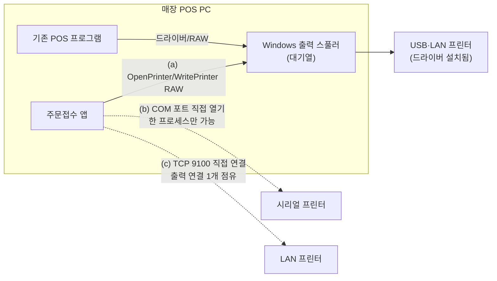

# 매장 주문접수 프로그램 기술 리서치 (1차 자료 기반)

- **작성일**: 2026-11-12
- **작성 주체**: Claude 리서치 에이전트 (claude-code/claude-opus-5-5)
- **범위**: Windows 버전 지원 현황, Tauri v2 세부 기능, Next.js 정적 내보내기, 영수증 프린터 출력(ESC/POS·Windows 출력 경로), 클라우드→매장 PC 실시간 전달, 신뢰성 패턴, Windows 코드 서명, 국내 주문접수 프로그램 사양 벤치마크
- **이 문서의 신뢰 기준**
  - 공식 문서·표준 문서(1차 자료)만 근거로 쓴다. 블로그·포럼은 근거로 쓰지 않는다. 부득이하게 2차 자료나 검색 엔진 요약을 거친 경우 그 사실을 문장 안에 밝힌다.
  - 모든 사실 주장에는 출처 링크를 붙인다. 문서에 버전·날짜가 있으면 함께 적는다. 모든 링크의 접근일은 2026-11-12다.
  - 확인하지 못한 내용은 **"확인 불가"**로 표시하고, 무엇을 시도했는지 적는다. 출처끼리 말이 다르면 그 충돌을 그대로 적는다.
  - 이 문서는 사실과 장단점만 정리한다. 최종 결정은 하지 않는다.

---

## 1. 요약 (핵심 발견)

1. **Tauri는 2.12(2026-09-26)부터 Windows 7 공식 지원을 중단했다.** 공식 발표는 최신 WebView2 설치 프로그램이 Win7에서 실행되지 않는 것을 이유로 들고, MSRV를 1.77(내장 Win7 지원이 있던 마지막 Rust)에서 1.90으로 올렸다([Tauri 2.12 발표](https://v2.tauri.app/blog/tauri-2.12)). WebView2 Runtime은 버전 109(2023년 1월)가 Win7/8/8.1용 마지막 버전이다([MS Edge 블로그](https://blogs.windows.com/msedgedev/2022/12/09/microsoft-edge-and-webview2-ending-support-for-windows-7-and-windows-8-8-1/)). Rust 표준 Windows 타깃도 1.78부터 최소 Windows 10이다([Rust 블로그](https://blog.rust-lang.org/2024/02/26/Windows-7/)). 현재 공식 플러그인들은 Rust 1.90 이상을 요구한다([single-instance](https://v2.tauri.app/plugin/single-instance/)). Prerequisites 페이지에는 아직 "Windows 7 and later"가 남아 있지만, 이는 2.12 발표 이전 내용이 갱신되지 않은 것으로 보인다(2.2절).
2. Electron(23부터)과 Flutter도 Windows 10 이상만 지원한다. 현재 .NET(10)도 마찬가지다. Win7 SP1에서 공식 설치가 가능한 런타임은 이 문서에서 확인한 것 중 **.NET Framework 4.8**뿐이다. 다만 MS는 Win7을 지원 종료 OS로 표시한다([.NET Framework 요구사항](https://learn.microsoft.com/en-us/dotnet/framework/get-started/system-requirements)).
3. Windows 10 22H2는 2025-10-14에 지원이 끝났다. 소비자 ESU는 2027-10-12까지다([MS ESU](https://www.microsoft.com/en-us/windows/extended-security-updates)). POS에 많이 쓰이는 **Windows 10 IoT Enterprise LTSC 2021은 2032-01-13까지** 지원된다([IoT 릴리스 이력](https://learn.microsoft.com/en-us/windows/iot/iot-enterprise/whats-new/release-history)).
4. Tauri 업데이터는 **서명이 필수이며 끌 수 없다.** 서명 키를 잃어버리면 이미 설치된 앱에는 업데이트를 더 배포할 수 없다. Windows에서는 설치 단계에서 앱이 자동으로 종료된다([Tauri Updater](https://v2.tauri.app/plugin/updater/)).
5. Next.js를 Tauri에 넣으려면 `output: 'export'`가 필수다. SSR, 요청에 의존하는 Route Handler, Server Actions, 미들웨어(Proxy), 기본 이미지 최적화 등은 쓸 수 없다([Next.js Static Exports](https://nextjs.org/docs/app/guides/static-exports), [Tauri Next.js 가이드](https://v2.tauri.app/start/frontend/nextjs/)).
6. **프린터 공유가 가장 큰 현장 리스크다.** 시리얼(COM) 포트는 한 프로세스만 독점해서 열 수 있다([MS](https://learn.microsoft.com/en-us/windows/win32/devio/communications-resource-handles)). Epson TM-T20IV의 9100 포트도 "출력 가능한 연결 수 1개, 연결을 해제할 때까지 점유"다([Epson TRG](https://files.support.epson.com/pdf/pos/bulk/tm-t20iv_trg_en_rev_d.pdf)). 스풀러(RAW) 경로는 Windows 출력 대기열을 거치므로 여러 프로그램이 같은 프린터를 함께 쓸 수 있는 구조다.
7. `GS V 66 n`의 동작은 **제조사·모델마다 다르다.** Epson은 "(절단 위치 + n×세로 이동 단위)만큼 용지를 보낸 뒤 부분 절단"이다. 반면 Bixolon SRP-350plusII는 절단 방식(전체/부분)이 메모리 스위치(MSW5-1)로 고정되어 있고, SRP-350plusA&C에서는 n이 버퍼 처리 방식을 뜻한다([Bixolon 매뉴얼](https://www.bixolon.com/_upload/manual/Manual_SRP-350352plusAC_controlcommands_english_Rev_1_04.pdf)).
8. 매장 PC는 NAT(공유기) 뒤에 있어 외부에서 먼저 연결을 걸 수 없다. 따라서 **PC가 먼저 서버로 연결을 열어야** 한다([RFC 5382](https://www.rfc-editor.org/rfc/rfc5382.html)). AWS ALB 유휴 타임아웃 기본값은 60초다([AWS](https://docs.aws.amazon.com/elasticloadbalancing/latest/application/edit-load-balancer-attributes.html)). nginx `proxy_read_timeout` 기본값도 60초다([nginx](https://nginx.org/en/docs/http/websocket.html)). 즉 하트비트가 필수다.
9. WebSocket(RFC 6455)과 SSE에는 메시지 재전송 보장이 없다. SSE는 `Last-Event-ID`로 재연결 지점만 알려준다([WHATWG](https://html.spec.whatwg.org/multipage/server-sent-events.html)). Redis Pub/Sub는 at-most-once라 구독자가 끊겨 있던 동안의 메시지는 사라진다([Redis](https://redis.io/docs/latest/develop/pubsub/)). AWS IoT Core는 QoS 2를 지원하지 않고, 영구 세션 기본 보관 시간이 1시간이다([AWS IoT](https://docs.aws.amazon.com/iot/latest/developerguide/mqtt.html)).
10. 코드 서명: **이제 EV 인증서로도 SmartScreen 경고를 바로 없앨 수 없다**([MS SmartScreen](https://learn.microsoft.com/en-us/windows/apps/package-and-deploy/smartscreen-reputation)). Microsoft Artifact Signing(구 Trusted Signing)은 **한국 "조직"은 Public Trust 대상이지만 "개인 개발자"는 미국·캐나다만** 가능하다([Quickstart](https://learn.microsoft.com/en-us/azure/artifact-signing/quickstart)).

---

## 2. Windows 버전 지원 현황

### 2.1 OS 지원 종료 일정

| 제품 | 지원 종료(연장 지원 종료) | ESU | 출처 |
|---|---|---|---|
| Windows 7 (SP1) | 2020-01-14 (PT 기준 1/15 06:59:59) | 볼륨 라이선스로 3년, 2023-01-10까지 (ESU Year 3 종료 1/11/2023 06:59 PT) | [MS Lifecycle – Windows 7](https://learn.microsoft.com/en-us/lifecycle/products/windows-7) (ms.date 2022-12-14) |
| Windows Embedded POSReady 7 | 2021-10-12 (PT 10/13 06:59) | OEM을 통해 ESU 3년, 2024-10-08까지 (PT 10/9 06:59) | [MS Lifecycle – POSReady 7](https://learn.microsoft.com/en-us/lifecycle/products/windows-embedded-posready-7) |
| Windows 10 Home/Pro (22H2) | 2025-10-14 | 조직: 연간 구매, 최대 3년. 1년차 기기당 $61, 매년 2배([MS ESU](https://learn.microsoft.com/en-us/windows/whats-new/extended-security-updates), ms.date 2025-11-17). 소비자: 2027-10-12까지(무료 동기화 / Rewards 1,000점 / $30)([MS 소비자 ESU](https://www.microsoft.com/en-us/windows/extended-security-updates)) | [MS Lifecycle – Win10 Home/Pro](https://learn.microsoft.com/en-us/lifecycle/products/windows-10-home-and-pro) |
| Windows 10 IoT Enterprise LTSC 2016 | 2026-10-13 (이미 종료) | — | [IoT Enterprise 릴리스 이력](https://learn.microsoft.com/en-us/windows/iot/iot-enterprise/whats-new/release-history) (ms.date 2026-09-29) |
| Windows 10 IoT Enterprise LTSC 2019 (1809) | 2029-01-09 | — | 같은 문서 |
| Windows 10 IoT Enterprise LTSC 2021 (21H2) | 2032-01-13 (일반 지원 종료 2027-01-12) | — | 같은 문서, [MS Lifecycle – IoT LTSC 2021](https://learn.microsoft.com/en-us/lifecycle/products/windows-10-iot-enterprise-ltsc-2021) |
| Windows 11 IoT Enterprise LTSC 2024 | 2034-10-10 | — | [IoT Enterprise 릴리스 이력](https://learn.microsoft.com/en-us/windows/iot/iot-enterprise/whats-new/release-history) |

- 조직용 Windows 10 ESU를 받으려면 기기가 **Windows 10 22H2**여야 한다([MS ESU](https://learn.microsoft.com/en-us/windows/whats-new/extended-security-updates)).
- 소비자 ESU 페이지에는 "등록 방법과 시기가 지역(예: EEA)에 따라 다를 수 있다"는 문구가 있다. **한국에 적용되는 조건은 확인 불가**(한국어 지역 페이지는 확인하지 않음).

### 2.2 런타임·프레임워크별 최소 Windows 버전

| 기술 | 최소 Windows / Win7 상태 | 출처 |
|---|---|---|
| **WebView2 Runtime** | Win7/8/8.1용 마지막 버전은 **109**(2023-01-12 주 출시). SDK 1.0.1519.0 이상은 Win7/8 미지원. Fixed Version이 109보다 높으면 Win7/8에서 시작하지 않는다. 현재 공식 지원 클라이언트는 Windows 10 SAC 1709 이상, Windows 10 Enterprise/IoT LTSC 2015·2016·2019·2021, Windows 11 | [MS Edge 블로그 (2022-12-09)](https://blogs.windows.com/msedgedev/2022/12/09/microsoft-edge-and-webview2-ending-support-for-windows-7-and-windows-8-8-1/), [WebView2 소개 – Supported Windows versions](https://learn.microsoft.com/en-us/microsoft-edge/webview2/) (updated 2026-10-02) |
| **Rust 컴파일러/표준 타깃** | Rust 1.78(2024-05)부터 `*-pc-windows-*` 타깃의 최소 버전은 Windows 10. `x86_64-pc-windows-msvc`는 Tier 1, "Windows 10+, Windows Server 2016+". Win7용 `x86_64-win7-windows-msvc` / `i686-win7-windows-msvc`는 **Tier 3**이고 rustup으로 미리 빌드된 std를 받을 수 없다(`build-std` 필요) | [Rust 블로그](https://blog.rust-lang.org/2024/02/26/Windows-7/), [rustc platform support](https://doc.rust-lang.org/nightly/rustc/platform-support.html), [win7-windows-msvc](https://doc.rust-lang.org/nightly/rustc/platform-support/win7-windows-msvc.html) |
| **Tauri v2** | 공식 Prerequisites 페이지의 지원 OS 목록에는 "Windows 7 and later"라고 적혀 있다. Webview Versions 페이지도 "WebView2 is supported on Windows 7 and newer"라고 쓴다. 그러나 **Tauri 2.12 발표(2026-09-26)에서 Win7 공식 지원 중단을 명시**했다([Tauri 2.12 발표](https://v2.tauri.app/blog/tauri-2.12)). Prerequisites 표기는 갱신되지 않은 것으로 보인다(아래 설명). 공식 플러그인(single-instance, autostart, window-state)은 Rust 1.90 이상을 요구한다 | [Tauri Prerequisites](https://v2.tauri.app/start/prerequisites/), [Webview Versions](https://v2.tauri.app/reference/webview-versions/), [single-instance](https://v2.tauri.app/plugin/single-instance/), [autostart](https://v2.tauri.app/plugin/autostart/), [window-state](https://v2.tauri.app/plugin/window-state/) |
| **Electron** | **Electron 23**(2023-02-07)부터 Win7/8/8.1 미지원. 마지막 지원 버전 Electron 22(Chromium 108)는 EOL이 2023-10-10까지 연장되었다 | [Electron 블로그](https://www.electronjs.org/blog/windows-7-to-8-1-deprecation-notice) |
| **.NET 10** | 지원 Windows 클라이언트 중 가장 오래된 것은 Windows 10 1607 (E). Win7/8.1은 목록에 없다 | [dotnet/core – 10.0 supported-os](https://github.com/dotnet/core/blob/main/release-notes/10.0/supported-os.md) |
| (참고) .NET 6 | Win7 SP1(2020-01-14), 8.1(2023-01-10)을 "Out of support OS"로 분류 | [dotnet/core – 6.0 supported-os](https://github.com/dotnet/core/blob/main/release-notes/6.0/supported-os.md) |
| **.NET Framework 4.8** | Win7 SP1(32/64-bit)에 별도 설치 가능. 단, 같은 표 각주에서 Win7·8.1과 21H2/22H2를 제외한 Win10을 "out-of-support"로 표시. 4.8.1은 Win10 20H2 이상 / Win11 | [.NET Framework system requirements](https://learn.microsoft.com/en-us/dotnet/framework/get-started/system-requirements) (ms.date 2024-04-24) |
| **Flutter (Windows desktop)** | 지원: Windows 10, 11 (x64, Arm64). "8 and earlier"는 Unsupported. **Win7은 표에 따로 없다** | [Flutter supported platforms](https://docs.flutter.dev/reference/supported-platforms) |
| **WPF** | WPF는 .NET과 .NET Framework 양쪽에 포함되므로 실행되는 런타임의 OS 지원을 따른다. .NET 10 위의 WPF는 Win10 1607 이상, .NET Framework 4.8 위의 WPF는 Win7 SP1에 설치 가능. **WPF 전용 OS 지원표는 확인하지 않았다**(위 두 문서에서 추론) | 위 .NET 10 / .NET Framework 문서 |

**Tauri의 Win7 지원 상태 (2.12에서 정리됨).** Tauri 2.12 발표는 "we finally decided it's time to drop Windows 7 support"라고 밝히고, 최신 WebView2 설치 프로그램이 Win7에서 실행되지 않는다는 점과 MSRV를 1.77에서 1.90으로 올린 점을 근거로 든다([Tauri 2.12 발표](https://v2.tauri.app/blog/tauri-2.12)). 아래는 2.12 발표를 찾기 전에 정리한 독립 근거이며, 발표 내용과 일치한다. Tauri 공식 문서(Prerequisites)는 여전히 "Windows 7 and later"라고 쓴다. 그러나 MS 문서 기준으로 Win7용 WebView2는 109에서 멈췄고, Rust 공식 문서 기준으로 1.78 이후 표준 타깃은 Win10 이상이다. 현재 공식 플러그인은 Rust 1.90 이상이 필요하다. 이 셋을 합치면 "최신 Tauri v2 + 공식 플러그인 + 표준 Rust 타깃" 조합은 Win7을 공식적으로 지원하지 않는다고 판단할 근거가 있다. **Tier 3 Win7 타깃으로 Tauri v2를 빌드해 실제로 동작시킨 공식 사례는 확인 불가**(Tauri 문서·docs.rs에서 찾지 못함). Prerequisites의 Win7 표기는 2.12 이전 내용이 갱신되지 않은 것으로 보인다.

---

## 2A. Windows 7을 지원해야 할 경우의 기술 선택지

> 이 절은 "Win7을 꼭 지원해야 한다면 어떤 언어·런타임이 현실적인가"에 대한 **사실만** 정리한다. 권장이나 결정은 하지 않는다. 2절에서 이미 출처를 단 사실(WebView2 109, Rust 1.78, Electron 23, .NET 10, Flutter)은 절 번호로만 가리킨다. 모든 링크의 접근일은 2026-11-12다.

**한 줄 결론.** 확인한 1차 자료 가운데 Win7 SP1을 아직 지원 표에 올려 둔 것은 .NET Framework 4.8(MS 요구사항 표), Qt 5.15(Qt 지원 플랫폼 표), jSerialComm(라이브러리 문서)이다. 다만 .NET Framework 4.8은 OS 구성요소라서 지원이 Win7의 수명 주기를 그대로 따르고, Qt 5.15 표준 지원은 2025-05-26에 끝났다. Oracle Java 8·11은 Win7을 "더 이상 지원하지 않음(No Longer Supported)"으로 옮겼고, Java 17·21과 Eclipse Temurin은 Win7을 목록에 아예 두지 않는다. Electron 22는 2023-10-10에 지원이 끝났고(2.2절), **Tauri는 2.12(2026-09-26)에서 Win7 공식 지원을 중단했다**(아래 표).

### 2A.1 기술별 비교

| 기술 | Win7 공식 지원 근거 | 화면 방식 | 실시간 수신(WebSocket 등) Win7 제약 | TLS/HTTPS Win7 제약 | 프린터·COM 포트 접근 | 출처 |
|---|---|---|---|---|---|---|
| **C# + .NET Framework 4.8** (WinForms / WPF) | 요구사항 표에 "Windows 7 SP1 – 별도 설치 가능(4.6.2 ~ 4.8)"으로 나온다. 같은 표 각주는 Win7을 out-of-support로 표시한다(2.2절). Lifecycle FAQ: "4.5.2 and later follows the lifecycle policy of the underlying Windows OS". 4.8 지원 OS 표에는 Win7 SP1이 있다. 따라서 Win7 위의 4.8 지원은 Win7 지원 종료(2020-01-14, ESU 2023-01-10, 2.1절)를 따른다 | 네이티브(WinForms/WPF). WPF만 다룬 OS 지원표는 확인 불가(11절 3번) | **내장 `ClientWebSocket`은 Win7에서 쓸 수 없다.** MS 문서 원문: "the only public implementations of client and server WebSockets are supported on Windows 8 and Windows Server 2012". Win7에서 지원되는 것은 추상 클래스뿐이라 직접 구현하거나 다른 라이브러리를 써야 한다. SSE·롱 폴링(일반 HTTP)에 대한 Win7 제약 문장은 확인 불가 | **OS(SChannel)에 의존한다.** 원문: "Since .NET Framework is dependent on Schannel on Windows, the operating system dictates which versions can be negotiated". Win7 SChannel은 TLS 1.2 클라이언트가 "Disabled"(지원은 하지만 기본 꺼짐), TLS 1.3은 "Not supported"다. TLS 1.3은 Windows 11 / Server 2022부터 지원한다 | COM: `System.IO.Ports.SerialPort`가 .NET Framework 4.8에 포함되어 있다. 스풀러 RAW 출력: Win32 `WritePrinter` 계열(5.3절)을 P/Invoke로 호출하는 방식. .NET Framework용 공식 래퍼는 확인하지 않음 | [.NET Framework 요구사항](https://learn.microsoft.com/en-us/dotnet/framework/get-started/system-requirements), [Lifecycle FAQ – .NET Framework](https://learn.microsoft.com/en-us/lifecycle/faq/dotnet-framework), [ClientWebSocket (netframework-4.8)](https://learn.microsoft.com/en-us/dotnet/api/system.net.websockets.clientwebsocket?view=netframework-4.8), [TLS best practices with .NET Framework](https://learn.microsoft.com/en-us/dotnet/framework/network-programming/tls) (ms.date 2026-06-04), [Protocols in TLS/SSL (Schannel SSP)](https://learn.microsoft.com/en-us/windows/win32/secauthn/protocols-in-tls-ssl--schannel-ssp-), [SerialPort (netframework-4.8)](https://learn.microsoft.com/en-us/dotnet/api/system.io.ports.serialport?view=netframework-4.8) |
| **Java 8** (Swing / JavaFX) | Oracle JDK 8 인증 구성에서 Win7 SP1(x64, x86)은 "No Longer Supported – Previously supported Operating System. No longer supported by the Vendor." 구역에 있다. 현재 인증된 Windows 클라이언트는 Windows 11뿐이고, Windows 10도 같은 "No Longer Supported" 구역에 있다. Eclipse Temurin 지원 플랫폼 데이터(8 ~ 27)의 Windows는 10, 11, Server 2019/2022/2025뿐이다. 전신인 AdoptOpenJDK는 2020-04에 Win7 지원을 끝내면서 "should still work"라고만 적었다 | Swing은 Java SE 기본 구성요소다. JavaFX는 Oracle 지원 로드맵에서 Java 8 지원 일정의 예외로 따로 분리되어 있다. **JavaFX의 Win7 지원 문장은 확인 불가** | `java.net.http.WebSocket`은 **Java 11부터**("Since: 11")라 Java 8에는 없다. Java 8에서는 라이브러리가 필요하다. 예: Java-WebSocket은 "Java 8 and higher", "This library supports wss", MIT 라이선스. 이 라이브러리의 Win7 명시 여부는 확인 불가 | **TLS를 Java가 직접 구현한다(SChannel을 거치지 않음).** JSSE: "Implemented in 100% pure Java"(Java 11 가이드). MS도 "These registry settings only apply to Schannel SSP and don't affect any third-party (D)TLS and SSL implementations"라고 쓴다. Oracle JDK 8u261에서 TLS 1.3이 들어왔고(클라이언트 기본값은 꺼짐), 8u341부터 클라이언트에서도 기본으로 켜진다 | COM: jSerialComm는 "Windows XP and later (32-bit, 64-bit, ARM, and ARM64)"를 지원한다. 출력: `javax.print`의 `DocFlavor.BYTE_ARRAY.AUTOSENSE`("application/octet-stream")로 바이트 배열을 보낼 수 있다. 다만 Javadoc은 "The client must determine that data described using this DocFlavor is valid for the printer"라고 하고, 해석 방식은 "implementation dependent"라고 한다 | [Oracle JDK 8 인증 구성](https://www.oracle.com/java/technologies/javase/products-doc-jdk8-jre8-certconfig.html), [Temurin supported-platforms 데이터(adoptium.net 저장소, 최종 커밋 2026-09-25)](https://github.com/adoptium/adoptium.net/blob/main/src/data/supported-platforms.json), [AdoptOpenJDK 2020-04 공지](https://blog.adoptopenjdk.net/2020/04/adoptopenjdk-8u252-1107-and-1401-available/), [Oracle Java SE Support Roadmap](https://www.oracle.com/java/technologies/java-se-support-roadmap.html) (Updated 2026-10-20), [Java-WebSocket](https://github.com/TooTallNate/Java-WebSocket), [JSSE Reference Guide (11)](https://docs.oracle.com/en/java/javase/11/security/java-secure-socket-extension-jsse-reference-guide.html), [TLS registry settings](https://learn.microsoft.com/en-us/windows-server/security/tls/tls-registry-settings), [8u261 릴리스 노트](https://www.oracle.com/java/technologies/javase/8u261-relnotes.html), [8u341 릴리스 노트](https://www.oracle.com/java/technologies/javase/8u341-relnotes.html), [jSerialComm](https://fazecast.github.io/jSerialComm/), [DocFlavor.BYTE_ARRAY](https://docs.oracle.com/javase/8/docs/api/javax/print/DocFlavor.BYTE_ARRAY.html), [DocFlavor](https://docs.oracle.com/javase/8/docs/api/javax/print/DocFlavor.html) |
| **Java 11** | Oracle JDK 11 인증 구성에서도 Win7 SP1(x64)은 "No Longer Supported" 구역에 있다(Windows 10, 8도 같은 구역). Temurin 11의 Windows 목록에 Win7은 없다 | Swing. JavaFX(OpenJFX)는 JDK 11부터 JDK와 별도로 배포된다. Gluon 표 기준으로 JavaFX 11은 "ended", JavaFX 17 LTS는 최소 JDK 11이며 "until Oct 2026"이다. Win7 지원 문장은 확인 불가 | 표준 API `java.net.http.WebSocket`("A WebSocket Client.", Since 11)을 쓸 수 있다 | Java 8 행과 같다(JSSE 자체 구현). JSSE 11 가이드: SunJSSE는 "TLS (versions 1.0, 1.1, 1.2, and 1.3)"를 구현한다 | Java 8 행과 같다 | [Oracle JDK 11 인증 구성](https://www.oracle.com/java/technologies/javase/products-doc-jdk11certconfig.html), [java.net.http.WebSocket](https://docs.oracle.com/en/java/javase/11/docs/api/java.net.http/java/net/http/WebSocket.html), [Gluon JavaFX](https://gluonhq.com/products/javafx/) |
| **Java 17 / 21** | Oracle 인증 구성의 현재 목록에도, "No Longer Supported" 구역에도 **Win7이 없다**(17: Windows 11, Server 2016 ~ 2025. 21: 같은 범위. 둘 다 Windows 10은 "No Longer Supported"). 즉 Win7은 인증된 적이 없다 | Swing / JavaFX 17·21 | 표준 WebSocket API 있음 | JSSE 자체 구현 | Java 8 행과 같다 | [Oracle JDK 17 인증 구성](https://www.oracle.com/java/technologies/javase/products-doc-jdk17certconfig.html), [Oracle JDK 21 인증 구성](https://www.oracle.com/java/technologies/javase/products-doc-jdk21certconfig.html) |
| **C++ + Qt 5.15** | Qt 5.15 지원 플랫폼 표에 **Windows 7(x86, x86_64; MSVC 2019, MSVC 2017, MinGW 8.1)**이 있다. 같은 페이지 경고: "Support for specific configurations or operating system versions may end before the support for Qt 5.15 does." 상용 지원 종료는 2025-05-26이다. 이후에는 유료 Extended Security Maintenance(ESM) 구독만 있다. Qt 위키에 표기된 마지막 오픈소스 5.15 릴리스는 5.15.2(2020-11-20)다 | Qt 자체 UI(웹 엔진 불필요) | `QWebSocket`(Qt WebSockets 모듈, Since Qt 5.3)이 `wss://`를 지원한다 | **OpenSSL을 쓴다(SChannel 아님).** "From Qt version 5.15 onwards, the officially supported version for OpenSSL is 1.1.1 or later". 5.15.1부터는 OpenSSL 3과도 호환된다. OpenSSL은 앱과 함께 "not automatically deployed"이므로 직접 동봉해야 한다. OpenSSL 자체의 Win7 지원 여부는 확인 불가 | COM: Qt Serial Port 모듈. 스풀러 RAW: C++이므로 Win32 API(5.3절)를 직접 호출할 수 있다. Qt 자체의 RAW 출력 API는 확인하지 않음 | [Qt 5.15 Supported Platforms](https://doc.qt.io/qt-5/supported-platforms.html), [Qt 5.15 Release (wiki)](https://wiki.qt.io/Qt_5.15_Release), [Qt 5.15 ESM 공지](https://www.qt.io/blog/extended-security-maintenance-for-qt-5.15-begins-may-2025), [QWebSocket](https://doc.qt.io/qt-5/qwebsocket.html), [Secure Sockets Layer (SSL) Classes (Qt 5)](https://doc.qt.io/qt-5/ssl.html), [Qt Serial Port](https://doc.qt.io/qt-5/qtserialport-index.html) |
| **Qt 6** (참고) | Qt 6.12 지원 Windows: Windows 10(1809 이상), Windows 11, Windows on ARM. Win7·8은 언급이 없다. 원문: "Qt 6.12 will be the last version to support Windows 10." | — | — | — | — | [Qt 6 Supported Platforms](https://doc.qt.io/qt-6/supported-platforms.html) |
| **Electron 22** | Win7/8/8.1을 지원하는 마지막 메이저다(Chromium 108). EOL은 2023-10-10까지 연장되었다(2.2절) | 웹(Chromium 108 고정) | 확인 불가(이번에 조사하지 않음) | 확인 불가(Electron 22의 TLS 구현을 확인하지 않음) | 확인 불가(Electron 공식 API로 COM/RAW 출력이 되는지 확인하지 않음) | [Electron 블로그](https://www.electronjs.org/blog/windows-7-to-8-1-deprecation-notice), [Electron Timelines](https://www.electronjs.org/docs/latest/tutorial/electron-timelines) |
| **Tauri v1 / v2(2.11 이하)** | **Tauri 2.12(2026-09-26)에서 Win7 공식 지원을 중단했다.** 블로그 원문: "With the latest WebView2 installer no longer running on Windows 7 (crashes with `no entry point for GetPackagesByPackageFamily`) we finally decided it's time to drop Windows 7 support." 그동안 Rust 1.77("the last rust version with built-in Windows 7 support")에 머물렀고, 2.12부터 MSRV를 1.90으로 올렸다. 2.0.1 릴리스 노트(2024-10-03): "Downgrade MSRV to 1.77.2 to support Windows 7." v1 문서에는 "Supporting Windows 7" 절이 있다. `.msi`는 기본 설정으로는 Win7에서 동작하지 않는다(WebView2 부트스트래퍼 다운로드가 "might fail if TLS 1.2 is not enabled in the operating system"). `embedBootstrapper` 모드와 알림용 `windows7-compat` 기능이 있다. **Tauri v1의 현재 유지보수 상태는 확인 불가** | 웹(WebView2, Win7은 109 고정, 2.2절) | Rust 측 구현에 따름(6.5절). Win7에서 실제로 동작하는지는 확인 불가 | 확인 불가 | Rust 크레이트(5.4절). Win7 동작은 확인 불가 | [Announcing Tauri 2.12](https://v2.tauri.app/blog/tauri-2.12), [tauri@2.0.1 release](https://v2.tauri.app/release/tauri/v2.0.1/), [Tauri v1 – Windows Installer](https://v1.tauri.app/v1/guides/building/windows) |

**2절과의 관계(출처 충돌의 일부 해소).** 2.2절은 Tauri Prerequisites 페이지의 "Windows 7 and later" 표기와 MS·Rust 문서가 충돌한다고 적었다. Tauri 2.12 공식 블로그는 Win7 공식 지원 중단을 명시한다. 따라서 **2.12 이후 Tauri v2는 Tauri 스스로도 Win7을 지원하지 않는다.** Prerequisites 페이지의 표기는 2026-11-12 기준으로 블로그와 충돌한다. 2.11 이하 버전과 Rust 1.77 조합을 Win7에서 실제로 운영한 공식 사례는 여전히 확인 불가다(11절 1번).

### 2A.2 Win7 공통 제약

1. **웹 화면 엔진이 고정된다.** Win7에서 쓸 수 있는 웹 엔진은 WebView2 109(2023-01)와 Electron 22의 Chromium 108이 마지막이다(2.2절). Tauri 2.12 블로그에 따르면 최신 WebView2 설치 프로그램은 Win7에서 아예 실행되지 않는다([Tauri 2.12](https://v2.tauri.app/blog/tauri-2.12)). Next.js 화면을 재사용하려면 이 고정 엔진 위에서 돌려야 한다.
2. **TLS가 갈린다. OS에 맡기는 쪽과 직접 구현하는 쪽.**
   - OS(SChannel)에 맡기는 기술(.NET Framework 등): Win7은 TLS 1.2 클라이언트가 기본 꺼짐, TLS 1.3은 미지원이다([Schannel 프로토콜 표](https://learn.microsoft.com/en-us/windows/win32/secauthn/protocols-in-tls-ssl--schannel-ssp-)). 백엔드가 TLS 1.3만 허용하면 이 경로로는 연결할 수 없다(표에서 도출).
   - WinHTTP 기본 프로토콜에 TLS 1.1/1.2를 추가하려면 Win7 SP1에 **KB3140245**를 설치하고 `DefaultSecureProtocols` 레지스트리 값을 직접 추가해야 한다. 이 업데이트의 설치 프로그램은 그 값을 만들지 않는다([KB3140245](https://support.microsoft.com/en-us/topic/update-to-enable-tls-1-1-and-tls-1-2-as-default-secure-protocols-in-winhttp-in-windows-c4bd73d2-31d7-761e-0178-11268bb10392)). .NET Framework의 HTTP 스택이 WinHTTP를 쓰는지는 확인하지 않았다.
   - .NET Framework 쪽 레지스트리(`SchUseStrongCrypto`, `SystemDefaultTlsVersions`)는 기본값이 없어서 직접 추가해야 하고, 기기 전체에 영향을 준다([TLS best practices](https://learn.microsoft.com/en-us/dotnet/framework/network-programming/tls)).
   - TLS를 직접 구현하는 기술(Java JSSE, Qt + 동봉 OpenSSL)은 SChannel 레지스트리의 영향을 받지 않는다([TLS registry settings](https://learn.microsoft.com/en-us/windows-server/security/tls/tls-registry-settings)). 대신 TLS 라이브러리 보안 패치를 앱이 직접 따라가야 한다.
3. **공급사 "지원"과 "설치 가능"은 다르다.** .NET Framework 4.8은 Win7에 설치할 수 있지만 지원은 OS를 따라 끝났다. Oracle은 Java 8·11에서 Win7을 "No Longer Supported"로 옮겼다. 위 표의 어떤 선택지도 2026-11 기준 "Win7에서 현재 지원"이라는 공급사 문장은 확인되지 않았다.
4. **32비트 Win7 PC.** .NET Framework 4.8 요구사항 표와 Qt 5.15 표에는 32비트(x86)가 있다. Oracle JDK 8 x86은 "No Longer Supported" 구역에 있다. Adoptium은 Temurin 32비트 Windows 빌드(JDK 8, 11, 17)를 "2026년에 중단할 계획"이라고 밝혔다([Adoptium 공지 2025-12](https://adoptium.net/news/2025/12/solaris-win32-removal/)). 매장 PC가 32비트인지 확인이 필요하다.
5. **테스트 환경이 두 벌 필요하다.** Win7을 포함하면 같은 빌드를 Win7과 Win10/11 양쪽에서 검증해야 한다. TLS·웹 엔진·런타임 버전이 OS마다 다르기 때문이다(위 1, 2). Win7 테스트 기기나 VM을 어떻게 구할지는 이번 조사 범위 밖이다.

### 2A.3 판단 시 고려할 조건 (사실 매핑, 권장 아님)

| 조건 | 사실상 유리한 선택지 | 근거 |
|---|---|---|
| Win7 PC의 OS TLS 설정(레지스트리·KB 설치)을 매장마다 손대기 어렵다 | TLS를 직접 구현하는 Java(JSSE), Qt + 동봉 OpenSSL | 2A.2-2 |
| 실시간 수신에 WebSocket을 쓰기로 정해진다 | Java 11+ 표준 API, Java 8 + 라이브러리, Qt `QWebSocket`. .NET Framework는 Win7에서 내장 클라이언트를 쓸 수 없다 | 2A.1 표 |
| 실시간 수신이 SSE / 롱 폴링(일반 HTTP)으로 정해진다 | WebSocket 제약이 사라져 선택지가 넓어진다. 단 .NET Framework는 TLS 1.2를 OS에서 켜야 한다 | 2A.1 표, 2A.2-2 |
| 개발자 1명이 Java에 익숙하다 | Java 8/11 + Swing(단, Oracle 인증상 Win7은 No Longer Supported) | 2A.1 표 |
| Next.js 화면을 그대로 재사용하고 싶다 | Electron 22 / Tauri 2.11 이하. 둘 다 지원이 끝났고 웹 엔진이 108/109로 고정된다 | 2A.1 표, 2.2절 |
| 공급사 유료 지원을 받고 싶다 | Qt 5.15 ESM(유료, 보안 패치만). Oracle Java SE 8/11 Extended Support(로드맵상 8은 2030-12, 11은 2032-01까지). 단 OS 인증은 별개 | [Qt ESM](https://www.qt.io/blog/extended-security-maintenance-for-qt-5.15-begins-may-2025), [Oracle 로드맵](https://www.oracle.com/java/technologies/java-se-support-roadmap.html) |
| 같은 코드로 Win10/11도 지원해야 한다 | .NET Framework 4.8(Win10/11 기본 포함), Java, Qt 5.15(Win10 21H2, Win11 22H2 표기) | 2A.1 표 출처 |

- Qt 라이선스(참고): Qt는 상용 라이선스와 GNU LGPL v3로 제공되고, 일부 모듈은 GPL v3다([Qt 6 Licensing](https://doc.qt.io/qt-6/licensing.html)). 상용 지원(ESM 등)은 상용 라이선스가 전제다([Qt ESM](https://www.qt.io/blog/extended-security-maintenance-for-qt-5.15-begins-may-2025)).

---

## 3. Tauri v2 세부 사항

### 3.1 Windows 개발 전제조건
- 개발 PC에는 **Microsoft C++ Build Tools**("Desktop development with C++")와 **WebView2**가 필요하다. Rust는 MSVC 툴체인(`rustup default stable-msvc`)이어야 한다. "WebView 2 is already installed on Windows 10 (from version 1803 onward)"([Tauri Prerequisites](https://v2.tauri.app/start/prerequisites/)).
- MSI 빌드에는 VBSCRIPT 선택 기능이 필요하다([Tauri Prerequisites](https://v2.tauri.app/start/prerequisites/), [Windows Installer](https://v2.tauri.app/distribute/windows-installer/)).

### 3.2 WebView2 설치 모드(번들러 설정)
출처: [Tauri – Windows Installer](https://v2.tauri.app/distribute/windows-installer/)

| 모드 | 설치 시 인터넷 | 설치 파일 증가분 | 비고 |
|---|---|---|---|
| `downloadBootstrapper` (기본값) | 필요 | 0 MB | Win7 `.msi` 배포에는 권장하지 않음 |
| `embedBootstrapper` | 필요 | 약 1.8 MB | Win7 `.msi`의 TLS 1.2 문제 회피용 |
| `offlineInstaller` | **불필요** | 약 127 MB | 오프라인 환경용으로 권장 |
| `fixedRuntime` | **불필요** | 약 180 MB | WebView2 버전과 패치를 앱이 직접 관리 |
| `skip` | 불필요 | 0 MB | 런타임이 없으면 앱이 동작하지 않음. 비권장 |

인터넷이 불안정한 매장을 위한 관련 사실:
- `offlineInstaller`와 `fixedRuntime`은 설치 시점에 인터넷이 필요 없다(위 표).
- MS 문서상 Evergreen Runtime은 자동으로 업데이트된다. 그러나 **앱이 계속 실행 중이면 이전 런타임 버전을 계속 쓴다.** 새 버전을 쓰려면 앱을 재시작하거나 WebView2 환경을 다시 만들어야 하고, `NewBrowserVersionAvailable` 이벤트로 감지할 수 있다([WebView2 Distribution](https://learn.microsoft.com/en-us/microsoft-edge/webview2/concepts/distribution)). 며칠씩 켜 두는 매장 PC(설계 원칙 5)와 관련된다.
- Fixed Version 바이너리는 250MB가 넘는다. Windows 10에서 Fixed Version 120 이상을 쓰는 unpackaged Win32 앱은 `icacls`로 권한(ALL APPLICATION PACKAGES 등)을 부여해야 한다. 네트워크 경로(UNC)에서는 실행할 수 없다([WebView2 Distribution](https://learn.microsoft.com/en-us/microsoft-edge/webview2/concepts/distribution)). Tauri 문서는 fixedRuntime을 약 180MB라고 적어 MS의 "250MB 초과"와 수치가 다르다. 압축 여부의 차이로 보이지만 **확인 불가**.
- MS 문서는 "대다수 Windows 10 기기에는 WebView2 Runtime이 이미 설치되어 있지만, 일부는 없다"고 하며 존재 여부를 확인하라고 권장한다([WebView2 Distribution](https://learn.microsoft.com/en-us/microsoft-edge/webview2/concepts/distribution)).

### 3.3 업데이터 플러그인
출처: [Tauri – Updater](https://v2.tauri.app/plugin/updater/)

- **서명은 필수다**: "This cannot be disabled." 키는 `tauri signer generate -w ~/.tauri/myapp.key`로 만든다. 공개키는 `tauri.conf.json`에, 비밀키는 빌드할 때 환경변수 `TAURI_SIGNING_PRIVATE_KEY`(경로 또는 내용)와 `TAURI_SIGNING_PRIVATE_KEY_PASSWORD`로 넘긴다. **`.env` 파일은 동작하지 않는다.**
- **키를 분실하면** "you will NOT be able to publish new updates to the users that have the app already installed." 키 백업과 보관 절차가 필수다.
- `bundle.createUpdaterArtifacts: true`로 설정하면 업데이트 파일과 `.sig` 파일이 만들어진다(v1에서 옮겨온 경우 `"v1Compatible"`, v3에서 제거 예정).
- 업데이트 정보 제공 방식은 두 가지다:
  - 정적 JSON(S3/GitHub 등): `version`, 그리고 `platforms`의 `windows-x86_64` 같은 키마다 `url`과 `signature`(서명 파일 경로가 아니라 내용).
  - 동적 서버: 업데이트가 없으면 `204 No Content`, 있으면 `200` + `url`/`version`/`signature`.
- JS API 흐름: `check()` → `downloadAndInstall()`(Started/Progress/Finished 이벤트) → `@tauri-apps/plugin-process`의 `relaunch()`.
- **Windows 동작**: "On Windows the application is automatically exited when the install step is executed"(Windows 설치 프로그램의 제약 때문). 업데이트 설치 중에는 주문을 받을 수 없으므로, 언제 업데이트할지를 따로 설계해야 한다.
- `windows.installMode`:
  - `passive`(기본값): 작은 진행 창, 사용자 조작 불필요.
  - `basicUi`: 사용자가 조작해야 함.
  - `quiet`: 진행 표시 없음. **사용자 단위 설치이거나 앱이 이미 관리자 권한으로 실행 중일 때만 동작**한다. 일반적으로 비권장.

### 3.4 NSIS 설치 범위(installMode)와 UAC, MSI vs NSIS
출처: [Tauri – Windows Installer](https://v2.tauri.app/distribute/windows-installer/)

| NSIS installMode | 설치 위치 | 관리자 권한 |
|---|---|---|
| `currentUser` (기본값) | `%LOCALAPPDATA%` | 불필요 |
| `perMachine` | `C:/Program Files` | **필요** |
| `both` | 설치 시 사용자가 선택 | 설치 프로그램 실행에 **필요** |

- Tauri 문서는 관리자 권한이 필요하다는 것까지만 쓰고, UAC 창이 어떻게 뜨는지는 설명하지 않는다. `perMachine`으로 설치하면 업데이트할 때마다 관리자 권한이 필요할 것으로 보인다. 다만 이것은 위 `quiet` 모드 설명에서 나온 추론이고, **업데이트 시 UAC 창이 매번 뜨는지는 확인 불가**.
- MSI는 WiX Toolset v3를 쓰고 **Windows에서만 빌드**할 수 있다. NSIS(`-setup.exe`)는 Linux/macOS에서 교차 빌드할 수 있지만 "not as straight forward", "not tested as much"이므로 최후의 수단으로 권장된다.
- Win7: 기본 `.msi`는 부트스트래퍼 다운로드 중 TLS 1.2 문제로 동작하지 않을 수 있어 `embedBootstrapper`가 필요하다. NSIS는 Win7에서 `downloadBootstrapper`를 지원한다. Win7에서 Notification API를 쓰려면 `windows7-compat` Cargo feature가 필요하다.
- 업데이터 관점에서 MSI와 NSIS 중 무엇이 나은지에 대한 Tauri 공식 권고는 **확인 불가**(Updater 문서에서 찾지 못함).

### 3.5 공식 플러그인(v2) 현황

| 기능 | 형태 | Windows 지원 | 비고 | 출처 |
|---|---|---|---|---|
| 자동 시작 | `autostart` 플러그인 | ✅ | JS `enable()/disable()/isEnabled()`, Rust 1.90 이상. Windows에서 레지스트리를 쓰는지 등 구현 방식은 문서에 없음(**확인 불가**) | [autostart](https://v2.tauri.app/plugin/autostart/) |
| 단일 인스턴스 | `single-instance` 플러그인 | ✅ | "must be the first one to be registered". JS API 없음, Rust 1.90 이상 | [single-instance](https://v2.tauri.app/plugin/single-instance/) |
| 시스템 트레이 | **코어 기능**(`tauri` crate의 `tray-icon` feature) | ✅ | Rust `TrayIconBuilder`, JS `TrayIcon.new()` | [System Tray](https://v2.tauri.app/learn/system-tray/) |
| 알림 | `notification` 플러그인 | ✅ | Windows에서는 "Only works for installed apps". 개발 중에는 PowerShell 이름과 아이콘으로 표시 | [notification](https://v2.tauri.app/plugin/notification/) |
| 창 상태 저장 | `window-state` 플러그인 | ✅ | 창 위치·크기 저장/복원, Rust 1.90 이상 | [window-state](https://v2.tauri.app/plugin/window-state/) |
| 업데이터 | `updater` 플러그인 | ✅ | 3.3절 | [updater](https://v2.tauri.app/plugin/updater/) |

- 플랫폼 지원 표시는 [plugins-workspace README](https://raw.githubusercontent.com/tauri-apps/plugins-workspace/v2/README.md)의 표를 기준으로 했다. 데스크톱 3종(Win/Mac/Linux)은 ✅이고, autostart/single-instance/window-state/updater는 모바일 ❌다. 문서 사이트의 지원 표는 텍스트로 추출되지 않아 README로 대신 확인했다.

### 3.6 IPC와 장시간 백그라운드 작업
- **Commands**: Rust 함수에 `#[tauri::command]`를 붙이고 `generate_handler!`로 등록한다. 프런트엔드는 `@tauri-apps/api/core`의 `invoke`로 호출하며 Promise를 받는다. 인자는 JSON(camelCase 키)이다. `async` 커맨드는 "executed on a separate async task using `async_runtime::spawn`"([Calling Rust](https://v2.tauri.app/develop/calling-rust/)).
- **Events**: `emit` / `emit_to` / `emit_filter` / `listen`. 제약은 다음과 같다: "not type safe, are always async, cannot return values and only supports JSON payloads". "not designed for low latency or high throughput"이며 이벤트 데이터에는 capability 제어가 적용되지 않는다([Calling Rust](https://v2.tauri.app/develop/calling-rust/), [Calling Frontend](https://v2.tauri.app/develop/calling-frontend/)).
- **Channels**: "designed to be fast and deliver ordered data". 스트리밍 데이터 전달에 권장된다([Calling Frontend](https://v2.tauri.app/develop/calling-frontend/)).
- **비동기 런타임**: `tauri::async_runtime`은 "The singleton async runtime used by Tauri", 즉 Tokio 기반이다. `spawn`, `spawn_blocking`, `block_on`, `set`(사용자 Tokio 런타임 지정)을 제공한다(docs.rs 표시 버전 tauri 2.12.5)([docs.rs](https://docs.rs/tauri/latest/tauri/async_runtime/index.html)). 실시간 수신 루프나 재연결 루프 같은 장시간 작업은 이 런타임에서 `spawn`한 태스크로 돌릴 수 있다. 화면이 닫혀도 Rust 쪽 작업이 계속 도는 구조이고, 화면에는 Channel/Event로 알린다.

### 3.7 Next.js를 Tauri와 쓰기(공식 가이드)
출처: [Tauri – Next.js](https://v2.tauri.app/start/frontend/nextjs/)
- "Use static exports by setting `output: 'export'`. Tauri doesn't support server-based solutions."
- `frontendDist`는 `../out`, 개발 시 `devUrl`은 `http://localhost:3000`이다.
- `images.unoptimized: true`는 "required to use the Next.js Image component in SSG mode". 개발 중에는 `assetPrefix`를 개발 서버 주소로 설정한다.

### 3.8 원격 URL을 웹뷰에 띄우고 Tauri 커맨드를 허용하기
출처: [Tauri – Capabilities](https://v2.tauri.app/security/capabilities/)
- 기본값: "By default the API is only accessible to bundled code shipped with the Tauri App."
- capability 파일의 `remote.urls`(예: `"https://*.tauri.app"`)로 원격 출처에 특정 권한만 줄 수 있다.
- 보안 경고:
  - "Please consider usage of this feature very carefully".
  - Linux와 Android에서는 임베드된 `<iframe>`과 창 자체의 요청을 구분하지 못한다.
  - 보안 경계는 창 **label** 기준이다(제목이 아님).
  - 한 창이 여러 capability에 속하면 권한이 합쳐진다.
- 해석(사실 아님): 원격 화면(A-1)은 원격 서버가 뚫리면 그 서버가 허용된 Rust 커맨드(프린터 출력 등)를 호출할 수 있게 된다. 그래서 허용 범위를 최소화해야 한다는 함의가 있다.

---

## 4. Next.js 정적 내보내기 (공식 문서)

출처: [Next.js – Static Exports](https://nextjs.org/docs/app/guides/static-exports) (lastUpdated 2026-08-09)

**지원**
- Server Components는 **빌드할 때 한 번** 실행되어 정적 HTML이 된다.
- Client Components에서의 데이터 조회(SWR 등)와 클라이언트 측 라우팅(SPA처럼 동작)은 지원된다.
- Route Handlers는 `GET`만 되고 `export const dynamic = 'force-static'`이 필요하다.
- `next/image`는 **커스텀 로더**를 쓸 때만 된다.
- 브라우저 API(`window` 등)는 `useEffect` 같은 클라이언트 실행 구간에서만 접근해야 한다.

**미지원**(문서 목록 그대로)
- `dynamicParams: true`인 Dynamic Routes, `generateStaticParams()` 없는 Dynamic Routes
- Request에 의존하는 Route Handlers, Cookies, Rewrites, Redirects, Headers
- **Proxy**(구 Middleware), ISR, 기본 로더의 Image Optimization, Draft Mode
- **Server Actions**, Intercepting Routes

**버전 이력**: v13.3에서 `next export`가 deprecated되었고, v14.0에서 제거되어 `output: 'export'`로 대체되었다.

함의(사실 아님): 주문 ID처럼 실행 중에 정해지는 경로(`/orders/[id]`)는 빌드 시점에 경로를 나열할 수 없다. 그래서 쿼리 문자열이나 클라이언트 상태로 표현해야 한다.

---

## 5. 영수증·주문서 출력 (Windows)

### 5.1 ESC/POS 기본 명령

> **출처 접근 제한**: Epson ESC/POS Command Reference 온라인 페이지(download4.epson.biz)는 자동 수집(WebFetch·curl)에 HTTP 403을 반환했다. 그래서 (a) Epson 공식 PDF(files.support.epson.com의 Technical Reference Guide), (b) Bixolon 공식 PDF 매뉴얼, (c) Epson 명령 페이지를 검색 엔진 요약으로 간접 확인한 내용으로 대신했다. (c)는 표에 "검색 경유"라고 표시했다.

| 명령 | 바이트 | 기능 | 근거 |
|---|---|---|---|
| `ESC @` | 1B 40 | 프린터 초기화. 출력 버퍼를 비우고 모드를 전원 투입 시 상태로 되돌린다. 매크로 정의는 유지된다 | Epson [esc_atsign](https://download4.epson.biz/sec_pubs/pos/reference_en/escpos/esc_atsign.html) (**검색 경유**) |
| `ESC a n` | 1B 61 n | 정렬 선택. 일반적으로 0=왼쪽, 1=가운데, 2=오른쪽 | **Epson 원문 확인 불가**(403. 값은 2차 자료에만 있었다). Bixolon 매뉴얼에 "Select justification" 명령이 있다는 것만 확인 |
| `GS ! n` | 1D 21 n | 문자 크기. 하위 4비트는 세로, 상위 4비트는 가로 배율(각 1~8배). Bixolon 문서는 "multi-byte code characters such as Chinese, Japanese, and Korean"에도 적용되며 멀티바이트 문자 크기는 이 명령으로만 지정한다고 명시 | [Bixolon SRP-350plusII Command Manual Rev 1.02](https://www.bixolon.com/_upload/manual/Manual_SRP-350352plusII_Command_Rev_1_02%5B0%5D.pdf), Epson [gs_exclamation](https://download4.epson.biz/sec_pubs/pos/reference_en/escpos/gs_exclamation.html) (**검색 경유**) |
| `GS V m` / `GS V m n` | 1D 56 m (n) | 용지 절단. 아래 상세 | 아래 |
| 부저 | `ESC ( A` (Function 48 등) / `ESC p` | Epson: TM-T88V/VI/VII 등에서 `ESC ( A` Function 48 "Beep the buzzer". `ESC p`는 서랍 킥 단자로 펄스를 내보낸다. **TM-T88V는 내장 부저가 일부 사양에만 있고**, 외장 부저(OT-BZ20)는 서랍 킥 단자를 쓰므로 **금전함과 동시에 쓸 수 없다** | [Epson TM-T88V TRG Rev.E](https://files.support.epson.com/pdf/pos/bulk/tmt88v_trg_reve.pdf) (부저 하드웨어), Epson [esc_lparen_ca_fn48](https://download4.epson.biz/sec_pubs/pos/reference_en/escpos/esc_lparen_ca_fn48.html) (**검색 경유**) |

**`GS V 66 n`이 실제로 하는 일: 제조사·모델마다 다르다.**

| 출처 | `m=65/66` 동작 |
|---|---|
| Epson Command Reference (**검색 경유**, [cutting_paper](https://download4.epson.biz/sec_pubs/pos/reference_en/escpos/cutting_paper.html)) | Function B: 용지를 [절단 위치 + n × 세로 이동 단위]만큼 보낸 뒤 절단. 65 = 전체 절단(full cut), 66 = 부분 절단(한 점 남김). Epson 예시 `GS V 66 20` ≈ 절단 위치 + 1.25mm(20/406인치) |
| [Bixolon SRP-350plusII Rev 1.02](https://www.bixolon.com/_upload/manual/Manual_SRP-350352plusII_Command_Rev_1_02%5B0%5D.pdf) | "Feeds paper to (cutting position + n × vertical motion unit) and executes a partial cut(one point left uncut)". 비고: "**Cutting mode is changed only by setting MSW5-1**"(소프트웨어 명령으로 전체/부분 절단을 바꿀 수 없음). 오토커터가 없으면 용지만 보낸다 |
| [Bixolon SRP-350plusA&C Rev 1.04](https://www.bixolon.com/_upload/manual/Manual_SRP-350352plusAC_controlcommands_english_Rev_1_04.pdf) | 65/66: "Feeds and cuts paper (one point left uncut, full cut)". **n은 출력 버퍼 데이터 처리 방식**을 지정한다(n=1,49는 출력 후 절단, n=0,48은 버퍼 삭제). "Full cut or one point left uncut cannot be changed by software" |

→ 같은 바이트열도 모델에 따라 이송 거리나 절단 방식이 달라질 수 있다. 실물 프린터로 확인해야 하는 항목이다(QA 체크리스트 대상).

### 5.2 한글 출력
- **Epson 한국 모델**: TM-T88V는 "Korean Kanji (KC C5601): 8,366 (for Korean model)"을 내장한다([TM-T88V TRG Rev.E](https://files.support.epson.com/pdf/pos/bulk/tmt88v_trg_reve.pdf), "Character Specifications". 원문 표기 "KC C5601"은 KS C 5601로 보인다). 즉 한국 모델 펌웨어에 한글 글꼴이 들어 있다.
- **Epson `FS &`(Kanji 모드 선택)**: 한국 모델 노트에 "Kanji mode is selected at default"이고, Kanji 코드를 지정하면 Kanji 첫 바이트에 해당하는 ASCII 문자는 출력할 수 없다(**검색 경유**, [fs_ampersand](https://download4.epson.biz/sec_pubs/pos/reference_en/escpos/fs_ampersand.html)). `FS C`(Kanji 코드 체계 선택)는 "effective only with Japanese model"이다(**검색 경유**, [fs_cc](https://download4.epson.biz/sec_pubs/pos/reference_en/escpos/fs_cc.html)).
- **Epson `FS ( C` Function 48(문자 인코딩 선택)**: TM-m30III, TM-T88VII 등 신형 모델이 대상이다. **TM 모델에서 UTF-8을 선택하는 정확한 파라미터 값은 확인 불가**(403. 검색 요약에도 값이 없었다).
- **Bixolon**: 매뉴얼은 `GS !`, `ESC !` 등의 비고에서 "multi-byte characters such as Kanji, Japanese and Korean"을 언급한다. 하지만 SRP-350plusII / plusA&C 명령 매뉴얼에서 **한글 모드를 켜는 별도 명령(FS 계열)은 찾지 못했다.** 국제 문자 집합 표에 "13 Korea"가 있다. 한국 모델이 KS X 1001(완성형) 2바이트를 기본으로 해석하는지는 **확인 불가**(Bixolon 한국어 코드페이지 매뉴얼은 확인하지 못함).
- **세우테크(Sewoo/SLK)**: 한글 처리 방식에 대한 1차 자료는 **확인 불가**. 검색에서는 영문 사용자 매뉴얼(판매점 호스팅)만 나왔고, 제조사 명령어 매뉴얼은 찾지 못했다.
- **래스터(이미지) 출력 대안**: Epson과 Bixolon 모두 래스터 비트 이미지 명령(`GS v 0`)을 제공한다([Bixolon Rev 1.04 명령 목록](https://www.bixolon.com/_upload/manual/Manual_SRP-350352plusAC_controlcommands_english_Rev_1_04.pdf), [Rev 1.02](https://www.bixolon.com/_upload/manual/Manual_SRP-350352plusII_Command_Rev_1_02%5B0%5D.pdf)). Epson은 Windows/Linux/Mac용 "full raster printer driver"를 제공한다([TM-T88V TRG](https://files.support.epson.com/pdf/pos/bulk/tmt88v_trg_reve.pdf)). 화면에서 그린 한글을 이미지로 바꿔 출력하면 프린터 내장 글꼴이나 코드페이지에 의존하지 않는다. 이런 방식이 업계에서 "흔하다"는 통계적 근거는 **확인 불가**.

### 5.3 Windows 출력 경로 3가지와 프린터 공유

| 경로 | 방법 | 공유 관점의 사실 | 출처 |
|---|---|---|---|
| (a) 스풀러 RAW | `OpenPrinter` → `StartDocPrinter`(DOC_INFO_1, `pDatatype="RAW"`) → `StartPagePrinter` → `WritePrinter` → `EndPagePrinter` → `EndDocPrinter` → `ClosePrinter` | 작업이 Windows 출력 대기열로 들어간다. 여러 프로그램의 작업이 같은 대기열을 거친다. 대기열이 동시 작업을 순서대로 처리하는 방식은 MS 문서 원문으로 직접 확인하지 않았다 | [MS – Send Data Directly to a GDI Printer](https://learn.microsoft.com/en-us/windows/win32/printdocs/sending-data-directly-to-a-printer) (ms.date 2018-05-31) |
| (b) COM 포트 직접 | `CreateFile("COM1")`. "dwShareMode must be zero (exclusive access)" | "If the specified resource is currently being used by another process, **CreateFile fails**." 기존 POS가 그 포트를 열고 있으면 우리 앱은 열 수 없다 | [MS – Communications Resource Handles](https://learn.microsoft.com/en-us/windows/win32/devio/communications-resource-handles), [MS – CreateFileW](https://learn.microsoft.com/en-us/windows/win32/api/fileapi/nf-fileapi-createfilew) |
| (c) TCP 9100 | 프린터 IP:9100에 소켓으로 ESC/POS 바이트를 보낸다 | Epson TM-T20IV: Port 9100, 양방향, 최대 동시 연결 6, **"Number of connections for which printing is available: 1 (occupied until the connection is released.)"**, 타임아웃 90초(변경 가능). 우리 앱이 연결을 오래 쥐고 있으면 다른 프로그램이 출력하지 못할 수 있다 | [Epson TM-T20IV TRG Rev.D](https://files.support.epson.com/pdf/pos/bulk/tm-t20iv_trg_en_rev_d.pdf) |

- Windows 표준 TCP/IP 포트 모니터(TCPMON)는 RAW TCP와 LPR 프로토콜을 지원하고 포트 번호를 지정할 수 있다(`PROTOCOL_RAWTCP_TYPE`, `dwPortNumber`). 즉 LAN 프린터도 Windows 프린터로 등록하면 (a) 스풀러 경로로 함께 쓸 수 있다([MS – TCPMON Xcv](https://learn.microsoft.com/en-us/windows-hardware/drivers/print/tcpmon-xcv-commands), [PORT_DATA_1](https://learn.microsoft.com/en-us/windows-hardware/drivers/ddi/tcpxcv/ns-tcpxcv-_port_data_1)). MS 문서에서 9100을 "기본값"으로 명시한 문장은 **확인 불가**.
- Epson은 USB/LAN 프린터를 가상 COM/LPT 포트로 노출하는 **TM Virtual Port Driver**를 제공한다([TM-T88V TRG](https://files.support.epson.com/pdf/pos/bulk/tmt88v_trg_reve.pdf)). 가상 COM 포트도 (b)처럼 독점되는지는 **확인 불가**.
- Epson TM-T88V의 USB는 Printer Class와 Vendor Class 중에서 고를 수 있다([TM-T88V TRG](https://files.support.epson.com/pdf/pos/bulk/tmt88v_trg_reve.pdf)). 어느 쪽이냐에 따라 Windows가 프린터를 인식하는 방식이 달라질 수 있지만, 그 세부는 이 리서치에서 다루지 않았다.

### 5.4 Rust 크레이트

| 경로 | 크레이트 | 최신 버전·날짜 | 성숙도 관련 사실 | 출처 |
|---|---|---|---|---|
| (a) 스풀러 | `windows` (Microsoft `windows-rs`) | 0.62.2 (2025-10-06) | `windows::Win32::Graphics::Printing::WritePrinter` 존재(`unsafe fn`). 저장소는 github.com/microsoft/windows-rs | [docs.rs](https://docs.rs/crate/windows/latest), [API 문서](https://microsoft.github.io/windows-docs-rs/doc/windows/Win32/Graphics/Printing/fn.WritePrinter.html) |
| (b) COM | `serialport` | 4.10.1 (2026-09-08) | MPL-2.0. Windows i686/x86_64 msvc 지원 | [docs.rs](https://docs.rs/crate/serialport/latest) |
| ESC/POS 생성 | `escpos` | 0.20.1 (2026-10-07) | 0.x 버전. feature: `serial_port`, `usb`, `native_usb`, `usbprint`(Windows 전용), `graphics` 등. 내장 드라이버 `Network`/`Console`/`File`. **페이지 코드는 PC437 등만 있고 한국어 페이지 코드 없음**. 문서화 커버리지 36.02% | [docs.rs](https://docs.rs/crate/escpos/latest) |
| (c) TCP | 표준 `std::net::TcpStream` / `tokio::net` | — | 별도 크레이트 불필요(위 `escpos`의 `Network` 드라이버도 있음) | — |

`windows-sys` 크레이트는 이번에 따로 확인하지 않았다.

---

## 6. 클라우드 → NAT 뒤 PC 실시간 전달

### 6.1 왜 PC가 먼저 연결해야 하나 (NAT)
- RFC 5382(TCP NAT 동작 요구사항, BCP 142): NAT는 매핑이 없는 외부발 SYN에 일반적으로 ICMP Port Unreachable로 응답하거나 조용히 버린다. 가장 보수적인 "Connection-Dependent Filtering"은 외부에서 시작한 연결을 전혀 허용하지 않는다([RFC 5382](https://www.rfc-editor.org/rfc/rfc5382.html)). 그래서 매장 PC가 서버로 **바깥 방향(outbound) 연결**을 먼저 열고, 서버는 그 연결로 주문을 보내야 한다.
- 같은 RFC는 "established connection idle-timeout"이 2시간 4분 미만이면 안 된다고 요구한다(REQ-5). 실제 매장 공유기가 이를 지키는지는 **확인 불가**(장비별로 다름). 대신 클라우드 쪽 중간장비(ALB 60초, nginx 60초)가 훨씬 짧다(6.3절).

### 6.2 방식별 특성

| 방식 | 근거 표준 | 재연결·누락 관련 표준 내용 | 출처 |
|---|---|---|---|
| WebSocket | RFC 6455 | HTTP/1.1 `GET` + `Upgrade: websocket`, `Connection: Upgrade` → 101 응답. Ping은 "may serve either as a keepalive or as a means to verify that the remote endpoint is still responsive". **메시지 수신 확인(ack)이나 재전송 메커니즘은 없다**(앱이 직접 만들어야 함) | [RFC 6455](https://www.rfc-editor.org/rfc/rfc6455.html) |
| SSE | WHATWG HTML §9.2 | MIME `text/event-stream`. 재연결 대기 시간 초기값은 "implementation-defined… a few seconds"이고 `retry` 필드로 변경. `id` 필드로 last event ID를 갱신하고, 재연결할 때 `Last-Event-ID` 헤더로 서버에 알린다. 프록시가 짧은 타임아웃으로 끊을 수 있어 "comment line… every 15 seconds or so"를 권장 | [WHATWG HTML](https://html.spec.whatwg.org/multipage/server-sent-events.html) (Last Updated 2026-11-11) |
| 롱 폴링 | RFC 6202 (Informational, 2011-04) | 서버가 이벤트가 생길 때까지 응답을 미룬다. 최대 지연은 "over three network transits". 타임아웃은 "generally 30 seconds is a safer value". 중간장비가 응답을 버퍼링할 수 있다 | [RFC 6202](https://www.rfc-editor.org/rfc/rfc6202.html) |
| 짧은 폴링 | (별도 표준 없음) | 주기적 조회. 지연은 조회 주기에 비례한다 | — |
| MQTT 5 | OASIS MQTT v5.0 (2019-03-07) | QoS 0 "At most once", QoS 1 "At least once"(중복 가능), QoS 2 "Exactly once". Session Expiry Interval이 0이거나 없으면 연결이 끊길 때 세션이 끝나고, 0보다 크면 연결이 끊긴 뒤에도 세션 상태를 저장해야 한다(MUST). Keep Alive 0은 비활성화 | [OASIS MQTT v5.0](https://docs.oasis-open.org/mqtt/mqtt/v5.0/os/mqtt-v5.0-os.html) |

**관리형 브로커: AWS IoT Core**([MQTT 문서](https://docs.aws.amazon.com/iot/latest/developerguide/mqtt.html), [쿼터](https://docs.aws.amazon.com/general/latest/gr/iot-core.html))
- QoS 0과 1만 지원하고, **QoS 2는 미지원**이다. MQTT DUP 플래그도 미지원이다.
- 영구 세션은 구독 정보와 **아직 ack되지 않은 QoS 1 메시지**를 저장한다. 재연결하면 최대 초당 10건으로 다시 보낸다.
- 영구 세션 만료 기본값은 3600초(조정 가능)다. 실제로는 최대 30분까지 더 유지될 수 있다. 만료되면 저장된 메시지는 폐기된다. 최대 조정 한도는 쿼터 문서에 **명시 없음**(확인 불가).
- 계정당 큐잉 속도는 초당 500건(조정 가능)이다. 한도를 넘는 메시지는 "will be dropped".
- Keep-alive: 0이거나 1200초를 넘게 요청하면 1200초를 쓰고, 30초 미만은 30초로 취급한다. 1.5×Keep Alive 동안 패킷이 없으면 연결을 끊는다.
- 연결당 publish는 초당 100건(조정 불가)이다.
- 오프라인 세션에 저장된 메시지는 재연결 후 전달될 때 **다시 과금**된다.
- 해석: 매장 PC가 밤새 꺼져 있으면(1시간 초과) 그동안의 메시지는 브로커에서 사라진다. 따라서 "재연결 시 미확인 주문 조회"(설계 원칙 1)는 MQTT를 쓰더라도 여전히 필요하다.

### 6.3 운영상 함정

| 항목 | 사실 | 출처 |
|---|---|---|
| AWS ALB WebSocket | "native support for WebSockets"(HTTP/1.1 Upgrade, HTTP/HTTPS 리스너 모두). target optimizer가 켜진 대상 그룹에서는 미지원 | [ALB Listeners](https://docs.aws.amazon.com/elasticloadbalancing/latest/application/load-balancer-listeners.html) |
| ALB 유휴 타임아웃 | 기본 **60초**, 1~4000초로 조정. "send at least 1 byte of data before each idle timeout period elapses". **HTTP/2 PING 프레임은 유휴 타임아웃을 초기화하지 않는다** | [ALB 속성](https://docs.aws.amazon.com/elasticloadbalancing/latest/application/edit-load-balancer-attributes.html) |
| ALB HTTP client keepalive | 기본 3600초(60~604800). 시간이 지나면 연결을 정상 종료한다(HTTP/1.x `Connection: close`, HTTP/2 `GOAWAY`). 트래픽이 있어도 초기화되지 않는다. 이 설정이 WebSocket으로 업그레이드된 연결에도 적용되는지는 문서에 명시 없음(**확인 불가**) | 같은 문서 |
| nginx WebSocket 프록시 | `proxy_set_header Upgrade $http_upgrade; proxy_set_header Connection "upgrade";`. 페이지에는 `proxy_http_version 1.1`이 "before version 1.29.7"에서만 필요하다는 주석이 있다. "By default, the connection will be closed if the proxied server does not transmit any data within 60 seconds"이므로 `proxy_read_timeout`을 늘리거나 서버가 ping을 보내야 한다 | [nginx WebSocket proxying](https://nginx.org/en/docs/http/websocket.html) |
| nginx SSE 버퍼링 | `proxy_buffering on`이 기본값이다. 응답 헤더 `X-Accel-Buffering: no`로 버퍼링을 끌 수 있다. `proxy_read_timeout` 기본 60초 | [ngx_http_proxy_module](https://nginx.org/en/docs/http/ngx_http_proxy_module.html) |
| 프록시 일반 | 중간장비가 응답 전체를 버퍼링하는 것도 합법이라 스트리밍이 동작하지 않을 수 있다 | [RFC 6202 §3.2](https://www.rfc-editor.org/rfc/rfc6202.html) |

### 6.4 서버 수평 확장 시 메시지 분배
- **Redis Pub/Sub**: "_at-most-once_ message delivery semantics… If the subscriber is unable to handle the message (for example, due to an error or a network disconnect) the message is forever lost." 더 강한 보장이 필요하면 Streams를 권장한다. Redis 7.0부터 Sharded Pub/Sub가 있다([Redis Pub/Sub](https://redis.io/docs/latest/develop/pubsub/)).
- **Redis Streams**: 메시지가 저장된다. at-most-once와 at-least-once를 모두 지원한다([Redis Pub/Sub](https://redis.io/docs/latest/develop/pubsub/)). 컨슈머 그룹 관련 명령은 다음과 같다([Redis Streams](https://redis.io/docs/latest/develop/data-types/streams/)).
  - `XREADGROUP`: 읽기
  - `XACK`: 처리 확인
  - `XPENDING`: 미확인 목록(PEL) 조회
  - `XCLAIM`/`XAUTOCLAIM`: 실패한 컨슈머의 메시지 회수
  - `XNACK`: 8.8.0 이상
- 해석: Pub/Sub는 "같은 매장 연결이 붙어 있는 서버 인스턴스에 알림을 전달하는 용도"로만 쓰고, 누락 방지는 DB와 미확인 조회로 보완하는 설계와 잘 맞는다. 이는 백엔드 팀의 영역이다.

### 6.5 Rust 클라이언트 크레이트

| 크레이트 | 버전·날짜 | 사실 | 출처 |
|---|---|---|---|
| `tokio-tungstenite` | 0.30.0 (2026-07-11) | TLS는 기본으로 꺼져 있다(`native-tls`, `rustls-tls-native-roots`, `rustls-tls-webpki-roots` 중 선택). **자동 재연결 기능은 문서에 없다**(직접 구현) | [docs.rs](https://docs.rs/crate/tokio-tungstenite/latest) |
| `eventsource-client` (LaunchDarkly) | 0.18.1 (2026-10-07) | 지수 백오프 자동 재연결, 마지막 이벤트부터 재개(Last-Event-ID) | [docs.rs](https://docs.rs/crate/eventsource-client/latest) |
| `rumqttc` | 0.25.1 (2025-11-21) | `v5` 모듈(MQTT 5)이 있다. 재연결은 `eventloop.poll()` 루프를 계속 돌리면 된다 | [docs.rs](https://docs.rs/crate/rumqttc/latest), [v5 모듈](https://docs.rs/rumqttc/latest/rumqttc/v5/index.html) |
| (참고) `tauri-plugin-websocket` | — | 공식 플러그인. "Open a WebSocket connection using a Rust client in JavaScript" | [Tauri 플러그인 목록](https://v2.tauri.app/plugin/) |

---

## 7. 신뢰성 패턴 (요약)

- **Idempotency-Key 헤더**: `draft-ietf-httpapi-idempotency-key-header-08`. httpapi WG의 Active Internet-Draft이고 **아직 RFC가 아니다**. Standards Track을 목표로 하며 IESG state는 "I-D Exists", 만료일은 2027-04-25다. 주요 내용은 다음과 같다([IETF Datatracker](https://datatracker.ietf.org/doc/draft-ietf-httpapi-idempotency-key-header/), 페이지 갱신 2026-10-22).
  - POST/PATCH를 안전하게 재시도하게 해 준다.
  - 키는 UUID 등 고엔트로피 값을 쓴다.
  - 같은 키를 다른 내용으로 재사용하면 422, 키가 필수인데 없으면 400, 원래 요청이 처리 중이면 409를 돌려준다.
  - 서버가 키를 만료시킨다면 그 정책을 공개해야 한다.
- **At-least-once + 중복 제거**: MQTT QoS 1은 "assured to arrive but duplicates can occur"([OASIS](https://docs.oasis-open.org/mqtt/mqtt/v5.0/os/mqtt-v5.0-os.html)). Redis Streams도 at-least-once를 지원한다([Redis](https://redis.io/docs/latest/develop/pubsub/)). 즉 "최소 한 번 전달"을 택하면 수신 측에서 `orderId`/`eventId`로 중복을 걸러야 한다(설계 원칙 2와 일치).
- **수신 확인(ack)**: WebSocket과 SSE 표준에는 메시지 단위 ack가 없다([RFC 6455](https://www.rfc-editor.org/rfc/rfc6455.html), [WHATWG](https://html.spec.whatwg.org/multipage/server-sent-events.html)). MQTT QoS 1은 프로토콜 수준의 PUBACK이 있지만, 이것은 "브로커→클라이언트 전달"에 대한 확인이지 "앱이 화면에 띄웠다"는 확인이 아니다. 앱 수준 ack(REST)는 별도로 필요하다는 함의가 있다(해석).

---

## 8. Windows 코드 서명

| 항목 | 사실 | 출처 |
|---|---|---|
| SmartScreen 동작 | 게시자 평판과 파일 해시 평판으로 판단한다. 서명된 새 바이너리도 평판이 쌓일 때까지 경고가 뜰 수 있다. "There is no exact threshold, but it can take several weeks and hundreds of clean installs from a wide audience." 같은 인증서로 서명하면 인증서 평판이 다음 버전으로 이어질 수 있다 | [MS – SmartScreen reputation](https://learn.microsoft.com/en-us/windows/apps/package-and-deploy/smartscreen-reputation) (ms.date 2026-05-04) |
| OV vs EV | OV/EV 모두 첫 다운로드 시 "unrecognized" 경고가 뜨고 게시자 이름이 표시된다. "**EV certificates no longer bypass SmartScreen**… Paying a premium for EV solely to avoid SmartScreen warnings is no longer justified." | 같은 문서 |
| 무서명/자체서명 | "Windows protected your PC", 사용자가 "Run anyway"를 눌러야 실행된다. 기업 정책으로 아예 차단될 수 있다 | 같은 문서 |
| Smart App Control | Windows 11에서는 Smart App Control이 SmartScreen을 대신할 수 있다. 평판이 없는 무서명 파일은 실행을 차단한다 | 같은 문서 |
| CA/B Forum 하드웨어 키 요건 | 2023-06-01부터 코드 서명 인증서의 개인키는 "generated, stored, and used in a suitable Hardware Crypto Module"이어야 한다. 기준은 FIPS 140-2 Level 2 또는 Common Criteria EAL 4+ (CSBR §6.2.7.4). 발효일은 Ballot CSC-17로 2023-06-01로 조정되었다 | [CSBR v3.9.0 PDF](https://cabforum.org/uploads/Baseline-Requirements-for-the-Issuance-and-Management-of-Code-Signing.v3.9.pdf), [Ballot CSC-17](https://cabforum.org/2022/09/27/ballot-csc-17-subscriber-private-key-extension/), [최신 CSBR](https://cabforum.org/working-groups/code-signing/requirements/) |
| 인증서 유효기간 | 최신 CSBR v3.11.0(2026-06-16): 2026-03-01 이후 발급 인증서는 최대 **460일** | [최신 CSBR](https://cabforum.org/working-groups/code-signing/requirements/) |
| MS 클라우드 서명 | 현재 이름은 **Artifact Signing**(구 Trusted Signing). 월 $9.99부터, 하드웨어 토큰 불필요, CI/CD 연동. EV는 발급하지 않고 계획도 없다. FIPS 140-3 Level 3. 무료/체험/스폰서 Azure 구독은 불가 | [MS – SmartScreen](https://learn.microsoft.com/en-us/windows/apps/package-and-deploy/smartscreen-reputation), [Artifact Signing FAQ](https://learn.microsoft.com/en-us/azure/artifact-signing/faq) |
| 한국에서 쓸 수 있나 | "Public Trust certificates are available to organizations in … **South Korea** … Individual developers must be located in the United States or Canada." Azure 리전에 Korea Central이 있다. 조직 신원 확인에는 영업일 기준 1~20일이 걸린다 | [Artifact Signing Quickstart](https://learn.microsoft.com/en-us/azure/artifact-signing/quickstart) (ms.date 2026-05-21) |
| Tauri 업데이터 서명과의 관계 | Tauri 업데이터 서명(3.3절)은 Windows Authenticode 서명과 **별개**다. 업데이터 서명은 업데이트 파일 위변조 검증용이고, SmartScreen과는 무관하다 | [Tauri Updater](https://v2.tauri.app/plugin/updater/), [MS SmartScreen](https://learn.microsoft.com/en-us/windows/apps/package-and-deploy/smartscreen-reputation) |

---

## 9. 벤치마크: 국내 주문접수 프로그램 공식 최소 사양

| 서비스 | 공식 최소 사양 / 지원 Windows | 시도한 것 |
|---|---|---|
| 배달의민족 주문접수 PC (배민주문접수 PC / PC LITE) | **확인 불가** | ceo.baemin.com 메인(소셜 링크만 있음), 웹 검색(한국어). 토스플레이스 공식 안내([2025-05-05](https://tossplace.com/story/windows_baemin))에서 "배민주문접수 PC Lite는 윈도우(Windows)에서만 사용할 수 있으며"까지만 확인. 버전·사양은 없음 |
| 쿠팡이츠 POS/주문접수 | **확인 불가** | 웹 검색. 공식 도움말·다운로드 페이지를 찾지 못함 |
| 요기요 사장님 PC 프로그램 | **확인 불가** | 웹 검색. 공식 도움말·다운로드 페이지를 찾지 못함 |
| 토스플레이스 토스 포스 | **확인 불가**(버전·사양) | [공식 제품 페이지](https://tossplace.com/product/pos)에는 "윈도우 (포스기, PC)", 안드로이드, iOS, Mac 지원만 표기. 사양은 고객센터와 guide.tossplace.com으로 안내(가이드 사이트는 확인하지 못함) |

---

## 10. 프로젝트 미결정 사항에 주는 시사점

> 사실과 장단점만 정리한다. 결정은 대표님·백엔드 팀 협의와 사용자 판단에 맡긴다.

### 10.1 Windows 7 지원 여부
- **사실**: Win7 자체, POSReady 7과 그 ESU는 모두 종료되었다(2.1절). Win7용 WebView2는 109에서 멈췄다. Rust 표준 타깃과 Electron, Flutter, .NET 10은 Win10 이상이다(2.2절). Win7 SP1에 공식 설치할 수 있는 런타임은 .NET Framework 4.8(WinForms/WPF)이 확인되었지만, MS는 해당 OS를 지원 종료로 표시한다.
- **트레이드오프**

| 선택 | 장점 | 단점·리스크 |
|---|---|---|
| Win7 제외(Win10 이상) | 1순위 후보(Tauri v2)를 표준 도구 그대로 쓸 수 있다. WebView2 보안 업데이트를 받을 수 있다 | Win7 매장은 PC 교체 또는 OS 업그레이드가 필요하다 |
| Win7 포함 | 기존 PC를 그대로 쓸 수 있다 | Tauri는 2.12부터 Win7 공식 지원을 중단했다([Tauri 2.12 발표](https://v2.tauri.app/blog/tauri-2.12)). 쓰려면 2.11 이하 + Rust 1.77 + WebView2 109에 고정해야 하고 실제 운영 사례도 확인되지 않았다. 또는 .NET Framework 4.8 등 다른 스택이 필요하다. 지원이 끝난 OS와 브라우저 엔진 위에서 결제 완료 주문을 다루게 된다 |

- Win10 매장도 일반판(22H2)은 이미 지원이 끝났다(ESU 제외). 반면 IoT Enterprise LTSC 2021이면 2032년까지 지원된다. "Win10 이상"을 고르더라도 **에디션 확인**(일반 Win10 vs IoT LTSC)이 필요하다.

### 10.2 프린터 모델·연결 방식
- **사실**: COM 포트는 프로세스 하나만 열 수 있다. Epson LAN(9100)은 출력 연결 1개를 점유한다. 스풀러 RAW 경로는 Windows 대기열을 공유한다(5.3절). `GS V` 등의 명령은 모델마다 다르게 동작한다(5.1절). 한글은 모델의 내장 글꼴(KS C 5601)에 의존하거나 래스터 이미지로 출력해야 한다(5.2절).
- **기존 POS와 같은 프린터를 쓸 때 확인할 질문**: 기존 POS가 그 프린터를 (1) Windows 프린터(드라이버)로 쓰는지, (2) COM 포트를 직접 여는지, (3) 9100으로 직접 연결하는지.
  - (1)이면 우리 앱도 스풀러로 같이 쓸 수 있는 구조다.
  - (2)이면 기존 POS가 포트를 열고 있는 동안 우리 앱은 열 수 없다.
  - (3)이면 서로 연결을 짧게 쥐어야 한다.
- **전용 프린터**를 두면 위 충돌은 사라지지만 하드웨어 비용과 설치 공간이 든다.

### 10.3 실시간 전달 방식
- **공통 사실**: 어느 방식이든 매장 PC가 바깥 방향으로 연결해야 한다(NAT). 클라우드 중간장비의 기본 유휴 타임아웃은 60초(ALB, nginx)라 하트비트가 필요하다. 어떤 방식도 "앱 수준 처리 완료"까지 보장하지 않으므로, ack와 재연결 시 미확인 조회가 필요하다(6, 7절).

| 방식 | 표준이 주는 것 | 별도로 만들어야 하는 것 | 인프라 고려 |
|---|---|---|---|
| WebSocket | 양방향, ping/pong | 재연결, 놓친 메시지 보충, ack | ALB 지원. nginx는 Upgrade 헤더와 timeout 설정 |
| SSE | 자동 재연결, `Last-Event-ID` | 서버 측 이벤트 보관 및 재전송, ack(별도 REST) | 프록시 버퍼링 해제(`X-Accel-Buffering: no`), 15초 주석 하트비트 |
| 롱 폴링 | 일반 HTTP | 커서 관리 | 30초 내외 타임아웃 권장(RFC 6202) |
| 짧은 폴링 | 일반 HTTP | 커서 관리 | 지연은 주기에 비례, 요청 수 증가 |
| MQTT(AWS IoT Core) | QoS 1, 영구 세션(기본 1시간) | 1시간 넘게 꺼져 있던 경우를 위한 조회, 중복 제거 | QoS 2 미지원, 재연결 후 초당 10건 재전송, 재과금 |

- 서버를 여러 대로 늘릴 때 Redis Pub/Sub는 끊긴 구독자에게 전달을 보장하지 않는다. Streams는 ack와 회수 기능이 있다(6.4절). 이 부분은 백엔드 팀이 담당한다.

### 10.4 화면 배포 방식 (A-1 원격 웹 / A-2 화면 내장)
- **A-2(내장)**
  - Next.js는 `output: 'export'`가 필수라 SSR, Server Actions, Proxy 등을 쓸 수 없다(4절).
  - 화면을 바꾸려면 Tauri 업데이터로 앱 전체를 업데이트해야 한다. Windows에서는 설치 중 앱이 종료된다(3.3절).
  - 기본 보안 경계(번들 코드만 API 접근)를 그대로 쓴다(3.8절).
- **A-1(원격)**
  - 화면만 서버에서 바로 바꿀 수 있다.
  - 원격 출처에 Rust 커맨드 권한을 주려면 capability `remote.urls`가 필요하다. 공식 문서는 "very carefully"를 요구한다(3.8절).
  - 인터넷이 끊기면 화면 로딩 자체가 실패할 수 있다. 오프라인 시 동작은 이 리서치에서 공식 근거를 찾지 못해 **확인 불가**.
- 두 방식 모두 WebView2 Runtime은 필요하다. 인터넷이 약한 매장은 `offlineInstaller`/`fixedRuntime`을 고려할 수 있다(3.2절).

---

## 11. 확인 불가 / 추가 확인 필요

1. ~~Tauri 문서의 "Windows 7 and later" 표기가 유효한지~~ → **해소**: Tauri 2.12 발표에서 Win7 공식 지원 중단 확인(20번 참고). 남은 확인 불가: Tier 3 `x86_64-win7-windows-msvc` 타깃으로 Tauri를 빌드해 Win7에서 동작시킨 공식 사례.
2. Windows 10 소비자 ESU의 한국 지역 조건(한국어 지역 페이지는 확인하지 않음).
3. WPF 전용 OS 지원표(이번에는 .NET / .NET Framework 문서로 추론).
4. Tauri `fixedRuntime` 크기 표기(약 180MB)와 MS 문서(250MB 초과)의 차이 원인.
5. NSIS `perMachine` 설치에서 업데이트할 때마다 UAC 창이 뜨는지. 업데이터 관점에서 MSI와 NSIS 중 무엇을 권하는지에 대한 Tauri 공식 권고.
6. autostart 플러그인의 Windows 구현 방식(레지스트리 Run 키 등).
7. Epson ESC/POS 온라인 레퍼런스 원문(download4.epson.biz가 자동 수집에 403 반환). 특히 `ESC a`의 파라미터 원문과 `FS ( C` Function 48에서 UTF-8을 선택하는 값. `ESC @`, `GS !`, `GS V`, `FS &`, `ESC ( A`는 검색 엔진 요약을 거쳐서만 확인했다.
8. Bixolon 한국 모델의 한글(KS X 1001) 기본 해석 방식과 한글 관련 전용 명령 유무(영문 명령 매뉴얼 2종에서는 찾지 못함).
9. 세우테크(SLK) 프린터의 한글 처리 방식(제조사 1차 자료를 찾지 못함).
10. 래스터 출력이 업계에서 흔한 대안이라는 정량 근거.
11. Epson TM Virtual Port Driver의 가상 COM 포트도 실제 COM처럼 독점되는지.
12. MS 문서에서 RAW TCP 포트 기본값을 9100으로 명시한 문장.
13. 스풀러가 여러 프로그램의 동시 RAW 작업을 섞지 않고 순서대로 처리한다는 MS 문서상의 명시 문장.
14. AWS IoT Core 영구 세션 만료 시간의 최대 조정 한도.
15. ALB "HTTP client keepalive duration"이 WebSocket 업그레이드 연결에도 적용되는지.
16. 실제 매장 공유기의 TCP 유휴 타임아웃(장비마다 다름. RFC 5382의 2시간 4분 요구를 지키는지).
17. A-1(원격 화면)에서 인터넷이 끊겼을 때 WebView2와 Tauri의 동작에 대한 공식 근거.
18. 배달의민족, 쿠팡이츠, 요기요, 토스 포스 주문접수 프로그램의 공식 최소 사양과 지원 Windows 버전.
19. `windows-sys` 크레이트 현황(이번에 확인하지 않음).

**2A절(Win7 지원 기술 선택지)에서 추가된 항목**

20. (1번 관련) Tauri 2.12 블로그는 Win7 공식 지원 중단을 명시하지만, Prerequisites 페이지에는 2026-11-12 기준으로 아직 "Windows 7 and later"가 남아 있다. Tauri 2.11 이하 + Rust 1.77 + WebView2 109 조합을 Win7에서 운영한 공식 사례, 그리고 Tauri v1의 현재 유지보수 상태(v1 문서·블로그에서 찾지 못함)는 확인 불가.
21. .NET Framework 4.8에서 Win7용으로 쓸 수 있는 WebSocket 클라이언트(서드파티나 직접 구현)에 대한 공식 근거. MS 문서는 "Win7에서는 추상 클래스만 지원"이라고만 쓴다.
22. .NET Framework `HttpClient`/`HttpWebRequest`(SSE·롱 폴링에 쓸 HTTP 스택)의 Win7 제약 문장. 이 스택이 WinHTTP를 쓰는지, 즉 KB3140245가 적용되는지도 확인하지 않음.
23. JavaFX(Oracle JDK 8 번들, OpenJFX/Gluon 11·17)의 Win7 지원 문장. openjfx.io와 gluonhq.com에는 OS 버전 문장이 없다. Oracle 지원 로드맵은 "JavaFX는 별도 절"이라고 쓰지만 해당 절을 페이지에서 찾지 못함.
24. Java-WebSocket 등 Java 8용 WebSocket 라이브러리의 Win7 명시. OkHttp 요구사항 페이지(square.github.io/okhttp)는 404를 반환해 확인하지 못함.
25. `javax.print`로 `DocFlavor.BYTE_ARRAY.AUTOSENSE` 바이트를 보낼 때 Windows 스풀러에 RAW로 그대로 전달되는지. Javadoc은 "implementation dependent"라고만 쓴다.
26. JSSE "Implemented in 100% pure Java" 문장은 Java 11 가이드에서만 확인했다(Java 8 가이드는 확인하지 않음). OpenJDK 8u(Temurin 등)에서 TLS 1.3이 들어온 버전도 확인하지 않음(Oracle JDK 8u261/8u341만 확인).
27. Qt 5.15가 쓰는 OpenSSL 1.1.1 / 3.x의 Win7 지원 여부. 5.15.2 이후 Qt 5.15 오픈소스판의 보안 패치 제공 여부(위키에 이후 오픈소스 릴리스 표기 없음).
28. Electron 22의 TLS 구현, COM 포트·RAW 출력 방법(이번에 조사하지 않음).
29. 지원이 끝난 Win7에서 루트 인증서 갱신이 계속되는지, 그리고 그에 따른 서버 인증서 체인 검증 문제(이번에 조사하지 않음).
30. Oracle JDK 8 이후 업데이트의 상용 이용 라이선스 조건(이번에 조사하지 않음).

---

## 12. 출처 목록 (접근일 모두 2026-11-12)

### Windows 지원·런타임
- Microsoft Lifecycle – Windows 7: https://learn.microsoft.com/en-us/lifecycle/products/windows-7
- Microsoft Lifecycle – Windows Embedded POSReady 7: https://learn.microsoft.com/en-us/lifecycle/products/windows-embedded-posready-7
- Microsoft Lifecycle – Windows 10 Home and Pro: https://learn.microsoft.com/en-us/lifecycle/products/windows-10-home-and-pro
- Microsoft Lifecycle – Windows 10 IoT Enterprise LTSC 2021: https://learn.microsoft.com/en-us/lifecycle/products/windows-10-iot-enterprise-ltsc-2021
- Windows 10 ESU (조직): https://learn.microsoft.com/en-us/windows/whats-new/extended-security-updates
- Windows 10 ESU (소비자): https://www.microsoft.com/en-us/windows/extended-security-updates
- Windows IoT Enterprise release history: https://learn.microsoft.com/en-us/windows/iot/iot-enterprise/whats-new/release-history
- Microsoft Edge and WebView2 ending support for Windows 7 and 8/8.1 (2022-12-09): https://blogs.windows.com/msedgedev/2022/12/09/microsoft-edge-and-webview2-ending-support-for-windows-7-and-windows-8-8-1/
- Introduction to Microsoft Edge WebView2: https://learn.microsoft.com/en-us/microsoft-edge/webview2/
- Distribute your app and the WebView2 Runtime: https://learn.microsoft.com/en-us/microsoft-edge/webview2/concepts/distribution
- Rust blog – Updated baseline standards for Windows targets: https://blog.rust-lang.org/2024/02/26/Windows-7/
- rustc Platform Support: https://doc.rust-lang.org/nightly/rustc/platform-support.html
- rustc – win7-windows-msvc: https://doc.rust-lang.org/nightly/rustc/platform-support/win7-windows-msvc.html
- Electron – Windows 7/8/8.1 deprecation notice: https://www.electronjs.org/blog/windows-7-to-8-1-deprecation-notice
- .NET 10 supported OS: https://github.com/dotnet/core/blob/main/release-notes/10.0/supported-os.md
- .NET 6 supported OS: https://github.com/dotnet/core/blob/main/release-notes/6.0/supported-os.md
- .NET Framework system requirements: https://learn.microsoft.com/en-us/dotnet/framework/get-started/system-requirements
- Flutter supported platforms: https://docs.flutter.dev/reference/supported-platforms

### Tauri v2
- Prerequisites: https://v2.tauri.app/start/prerequisites/
- Webview Versions: https://v2.tauri.app/reference/webview-versions/
- Windows Installer: https://v2.tauri.app/distribute/windows-installer/
- Updater plugin: https://v2.tauri.app/plugin/updater/
- Plugins index: https://v2.tauri.app/plugin/
- plugins-workspace README (v2): https://raw.githubusercontent.com/tauri-apps/plugins-workspace/v2/README.md
- Autostart: https://v2.tauri.app/plugin/autostart/
- Single Instance: https://v2.tauri.app/plugin/single-instance/
- Notification: https://v2.tauri.app/plugin/notification/
- Window State: https://v2.tauri.app/plugin/window-state/
- System Tray: https://v2.tauri.app/learn/system-tray/
- Calling Rust from the Frontend: https://v2.tauri.app/develop/calling-rust/
- Calling the Frontend from Rust: https://v2.tauri.app/develop/calling-frontend/
- tauri::async_runtime (docs.rs, tauri 2.12.5): https://docs.rs/tauri/latest/tauri/async_runtime/index.html
- Next.js guide: https://v2.tauri.app/start/frontend/nextjs/
- Capabilities: https://v2.tauri.app/security/capabilities/

### Next.js
- Static Exports (lastUpdated 2026-08-09): https://nextjs.org/docs/app/guides/static-exports

### 프린터·Windows 출력
- Epson TM-T88V Technical Reference Guide Rev.E: https://files.support.epson.com/pdf/pos/bulk/tmt88v_trg_reve.pdf
- Epson TM-T20IV Technical Reference Guide Rev.D: https://files.support.epson.com/pdf/pos/bulk/tm-t20iv_trg_en_rev_d.pdf
- Epson ESC/POS Command Reference (자동 수집 403, 검색 경유로만 확인): https://download4.epson.biz/sec_pubs/pos/reference_en/escpos/commands.html , …/esc_atsign.html , …/gs_exclamation.html , …/cutting_paper.html , …/gs_cv.html , …/fs_ampersand.html , …/fs_cc.html , …/fs_lparen_cc.html , …/esc_lparen_ca_fn48.html
- Bixolon SRP-350/352plusII Command Manual Rev 1.02: https://www.bixolon.com/_upload/manual/Manual_SRP-350352plusII_Command_Rev_1_02%5B0%5D.pdf
- Bixolon SRP-350/352plusA&C Control Commands Rev 1.04: https://www.bixolon.com/_upload/manual/Manual_SRP-350352plusAC_controlcommands_english_Rev_1_04.pdf
- MS – How To: Send Data Directly to a GDI Printer: https://learn.microsoft.com/en-us/windows/win32/printdocs/sending-data-directly-to-a-printer
- MS – Communications Resource Handles: https://learn.microsoft.com/en-us/windows/win32/devio/communications-resource-handles
- MS – CreateFileW: https://learn.microsoft.com/en-us/windows/win32/api/fileapi/nf-fileapi-createfilew
- MS – TCPMON Xcv Commands: https://learn.microsoft.com/en-us/windows-hardware/drivers/print/tcpmon-xcv-commands
- MS – PORT_DATA_1: https://learn.microsoft.com/en-us/windows-hardware/drivers/ddi/tcpxcv/ns-tcpxcv-_port_data_1
- docs.rs – serialport: https://docs.rs/crate/serialport/latest
- docs.rs – escpos: https://docs.rs/crate/escpos/latest
- docs.rs – windows: https://docs.rs/crate/windows/latest
- windows-rs API – WritePrinter: https://microsoft.github.io/windows-docs-rs/doc/windows/Win32/Graphics/Printing/fn.WritePrinter.html

### 실시간 전달·인프라
- RFC 6455 (WebSocket): https://www.rfc-editor.org/rfc/rfc6455.html
- WHATWG HTML – Server-sent events: https://html.spec.whatwg.org/multipage/server-sent-events.html
- RFC 6202 (Long Polling): https://www.rfc-editor.org/rfc/rfc6202.html
- RFC 5382 (NAT Behavioral Requirements for TCP): https://www.rfc-editor.org/rfc/rfc5382.html
- OASIS MQTT v5.0: https://docs.oasis-open.org/mqtt/mqtt/v5.0/os/mqtt-v5.0-os.html
- AWS IoT Core – MQTT: https://docs.aws.amazon.com/iot/latest/developerguide/mqtt.html
- AWS IoT Core – Endpoints and quotas: https://docs.aws.amazon.com/general/latest/gr/iot-core.html
- AWS ALB – Edit load balancer attributes: https://docs.aws.amazon.com/elasticloadbalancing/latest/application/edit-load-balancer-attributes.html
- AWS ALB – Listeners: https://docs.aws.amazon.com/elasticloadbalancing/latest/application/load-balancer-listeners.html
- nginx – WebSocket proxying: https://nginx.org/en/docs/http/websocket.html
- nginx – ngx_http_proxy_module: https://nginx.org/en/docs/http/ngx_http_proxy_module.html
- Redis – Pub/Sub: https://redis.io/docs/latest/develop/pubsub/
- Redis – Streams: https://redis.io/docs/latest/develop/data-types/streams/
- docs.rs – tokio-tungstenite: https://docs.rs/crate/tokio-tungstenite/latest
- docs.rs – eventsource-client: https://docs.rs/crate/eventsource-client/latest
- docs.rs – rumqttc: https://docs.rs/crate/rumqttc/latest , v5: https://docs.rs/rumqttc/latest/rumqttc/v5/index.html

### 신뢰성 패턴
- IETF – draft-ietf-httpapi-idempotency-key-header: https://datatracker.ietf.org/doc/draft-ietf-httpapi-idempotency-key-header/

### 코드 서명
- MS – SmartScreen reputation for Windows app developers: https://learn.microsoft.com/en-us/windows/apps/package-and-deploy/smartscreen-reputation
- MS – Artifact Signing Quickstart: https://learn.microsoft.com/en-us/azure/artifact-signing/quickstart
- MS – Artifact Signing FAQ: https://learn.microsoft.com/en-us/azure/artifact-signing/faq
- CA/B Forum – Code Signing BR v3.9.0 (PDF): https://cabforum.org/uploads/Baseline-Requirements-for-the-Issuance-and-Management-of-Code-Signing.v3.9.pdf
- CA/B Forum – Latest Code Signing BR (v3.11.0): https://cabforum.org/working-groups/code-signing/requirements/
- CA/B Forum – Ballot CSC-17: https://cabforum.org/2022/09/27/ballot-csc-17-subscriber-private-key-extension/

### Win7 지원 기술 선택지
- MS – Lifecycle FAQ – .NET Framework: https://learn.microsoft.com/en-us/lifecycle/faq/dotnet-framework
- MS – Microsoft .NET Framework lifecycle: https://learn.microsoft.com/en-us/lifecycle/products/microsoft-net-framework
- MS – ClientWebSocket (netframework-4.8): https://learn.microsoft.com/en-us/dotnet/api/system.net.websockets.clientwebsocket?view=netframework-4.8
- MS – TLS best practices with .NET Framework (ms.date 2026-06-04): https://learn.microsoft.com/en-us/dotnet/framework/network-programming/tls
- MS – Protocols in TLS/SSL (Schannel SSP) (ms.date 2025-03-20): https://learn.microsoft.com/en-us/windows/win32/secauthn/protocols-in-tls-ssl--schannel-ssp-
- MS – TLS registry settings (ms.date 2025-04-18): https://learn.microsoft.com/en-us/windows-server/security/tls/tls-registry-settings
- MS – KB3140245 (WinHTTP TLS 1.1/1.2 기본값): https://support.microsoft.com/en-us/topic/update-to-enable-tls-1-1-and-tls-1-2-as-default-secure-protocols-in-winhttp-in-windows-c4bd73d2-31d7-761e-0178-11268bb10392
- MS – SerialPort (netframework-4.8): https://learn.microsoft.com/en-us/dotnet/api/system.io.ports.serialport?view=netframework-4.8
- Oracle – JDK 8 and JRE 8 Certified System Configurations: https://www.oracle.com/java/technologies/javase/products-doc-jdk8-jre8-certconfig.html
- Oracle – JDK 11 Certified System Configurations: https://www.oracle.com/java/technologies/javase/products-doc-jdk11certconfig.html
- Oracle – JDK 17 Certified System Configurations: https://www.oracle.com/java/technologies/javase/products-doc-jdk17certconfig.html
- Oracle – JDK 21 Certified System Configurations: https://www.oracle.com/java/technologies/javase/products-doc-jdk21certconfig.html
- Oracle – Java SE Support Roadmap (Updated 2026-10-20): https://www.oracle.com/java/technologies/java-se-support-roadmap.html
- Oracle – JDK 8u261 Release Notes: https://www.oracle.com/java/technologies/javase/8u261-relnotes.html
- Oracle – JDK 8u341 Release Notes: https://www.oracle.com/java/technologies/javase/8u341-relnotes.html
- Oracle – JSSE Reference Guide (Java SE 11): https://docs.oracle.com/en/java/javase/11/security/java-secure-socket-extension-jsse-reference-guide.html
- Oracle – java.net.http.WebSocket (Java SE 11): https://docs.oracle.com/en/java/javase/11/docs/api/java.net.http/java/net/http/WebSocket.html
- Oracle – javax.print.DocFlavor.BYTE_ARRAY (Java SE 8): https://docs.oracle.com/javase/8/docs/api/javax/print/DocFlavor.BYTE_ARRAY.html
- Oracle – javax.print.DocFlavor (Java SE 8): https://docs.oracle.com/javase/8/docs/api/javax/print/DocFlavor.html
- Adoptium – supported-platforms 데이터 (adoptium.net 저장소, 최종 커밋 2026-09-25): https://github.com/adoptium/adoptium.net/blob/main/src/data/supported-platforms.json (렌더링 페이지: https://adoptium.net/supported-platforms/ — 자동 수집 시 버전별 표가 보이지 않아 저장소 데이터로 확인)
- AdoptOpenJDK – 8u252, 11.0.7, 14.0.1 Available (2020-04, Win7 지원 종료): https://blog.adoptopenjdk.net/2020/04/adoptopenjdk-8u252-1107-and-1401-available/
- Adoptium – Temurin 8u392, 11.0.21, 17.0.9, 21.0.1 Available (2023-11, Server 2012/R2 지원 종료): https://adoptium.net/blog/2023/11/eclipse-temurin-8u392-11021-1709-and-2101-available/
- Adoptium – Solaris·Windows 32비트 지원 종료 계획 (2025-12): https://adoptium.net/news/2025/12/solaris-win32-removal/
- Gluon – JavaFX 릴리스 표: https://gluonhq.com/products/javafx/
- OpenJFX: https://openjfx.io/
- Java-WebSocket (TooTallNate): https://github.com/TooTallNate/Java-WebSocket
- jSerialComm: https://fazecast.github.io/jSerialComm/ , 저장소: https://github.com/Fazecast/jSerialComm
- Qt 5.15 Supported Platforms: https://doc.qt.io/qt-5/supported-platforms.html
- Qt 6 Supported Platforms (Qt 6.12): https://doc.qt.io/qt-6/supported-platforms.html
- Qt 5.15 Release (wiki): https://wiki.qt.io/Qt_5.15_Release
- Qt – Extended Security Maintenance for Qt 5.15 begins May 2025: https://www.qt.io/blog/extended-security-maintenance-for-qt-5.15-begins-may-2025
- Qt 5 – Secure Sockets Layer (SSL) Classes: https://doc.qt.io/qt-5/ssl.html
- Qt 5 – QWebSocket: https://doc.qt.io/qt-5/qwebsocket.html
- Qt 5 – Qt Serial Port: https://doc.qt.io/qt-5/qtserialport-index.html
- Qt 6 – Qt Licensing: https://doc.qt.io/qt-6/licensing.html
- Electron – Electron Timelines: https://www.electronjs.org/docs/latest/tutorial/electron-timelines
- Tauri – Announcing Tauri 2.12 (2026-09-26): https://v2.tauri.app/blog/tauri-2.12
- Tauri – tauri@2.0.1 release notes (2024-10-03): https://v2.tauri.app/release/tauri/v2.0.1/
- Tauri v1 – Windows Installer (Supporting Windows 7): https://v1.tauri.app/v1/guides/building/windows
- Tauri v1 – Prerequisites (Win7 언급 없음): https://v1.tauri.app/v1/guides/getting-started/prerequisites

### 국내 벤치마크
- 토스플레이스 – 윈도우 포스에서 배달의민족 주문을 직접 받을 수 있어요 (2025-05-05): https://tossplace.com/story/windows_baemin
- 토스플레이스 – 토스 포스 제품 페이지: https://tossplace.com/product/pos
- 배민외식업광장: https://ceo.baemin.com/
